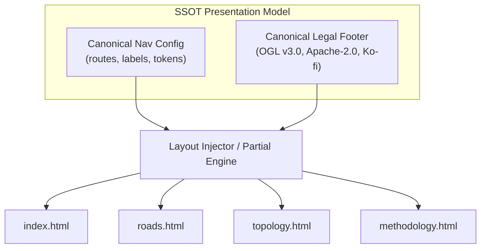
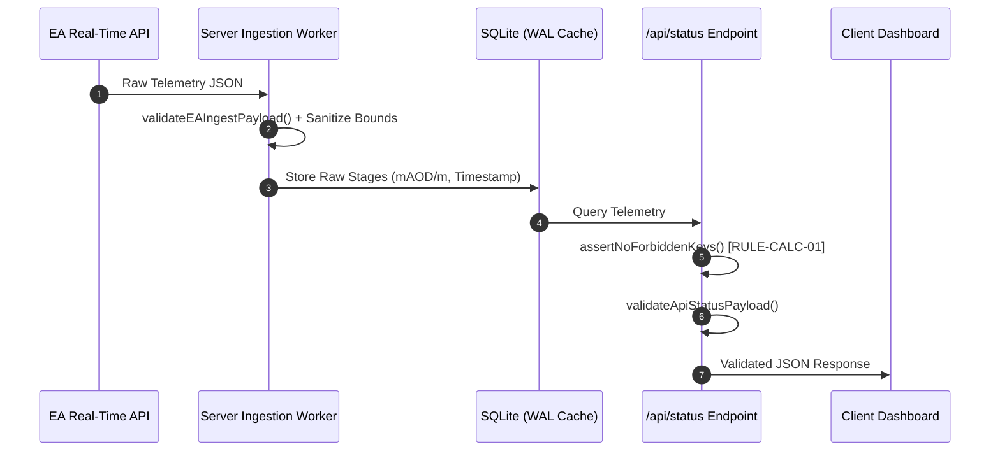
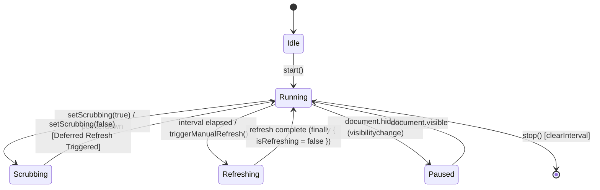

# Somerset Flood Telemetry: Systemic Software Architectural Principles

**Status:** Authoritative Architectural Standard  
**Governing Rules:** `AGENTS.md` (`[RULE-HUM-01]`, `[RULE-CALC-01]`, `[RULE-ENT-01]`, `[RULE-SSOT-01]`, `[UI-VIS-01]`)  
**Scope:** Frontend views, Node.js endpoints, SQLite caching, state controllers, and data contracts.

---

## 1. Executive Self-Reflection: The "Boilerplate" Fallacy

During sprint v2.1, updating a single link label required modifying five separate files (`index.html`, `roads.html`, `topology.html`, `methodology.html`, `app.js`). Over 400 lines of identical `<nav>` and `<footer>` markup were duplicated across pages. 

The review failed to flag this because of **Domain-Specific Tunnel Vision**: the auditor ruthlessly scrutinized vertical datums (mAOD), alert inequalities, XSS filters, and trichromatic contrast, but treated the presentation layer as "just static HTML boilerplate." In a zero-trust civic telemetry platform, **no code is "just boilerplate"**. Duplication guarantees state drift, broken accessibility, conflicting legal disclaimers, and maintenance paralysis.

---

## 2. Core Architectural Invariant Matrix

| Invariant Code | Domain Area | Invariant Rule & Mathematical Formulation | Violation Penalty |
| :--- | :--- | :--- | :--- |
| **`[ARCH-VIEW-01]`** | Presentation | $\forall T_1, T_2 \in \text{Templates}, \; \text{Layout}(T_1) \cap \text{Layout}(T_2) \equiv \emptyset$ (No duplicated shell markup). | **Instant Rejection** |
| **`[ARCH-DATA-01]`** | Contracts | $\forall D_{\text{in}}, D_{\text{out}}, \; \text{Validate}(D, \text{Schema}) = \text{true} \land \text{Keys}(D) \cap \text{Forbidden} = \emptyset$. | **Instant Rejection** |
| **`[ARCH-CTRL-01]`** | State Lifecycle | Single-instance controllers; zero unguarded timers or leaked global state flags. | **Instant Rejection** |
| **`[ARCH-RESI-01]`** | Degradation | Card-level error boundaries; offline detection; explicit stale telemetry age. | **Instant Rejection** |
| **`[ARCH-GATE-01]`** | Verification | Build pipeline requires: `eslint` (`no-undef`) $\to$ unit/contract tests $\to$ headless Chrome snapshot. | **Build Blocked** |
| **`[ARCH-SSOT-01]`** | Global SSOT | Universal SSOT: numeric datums, CSS design tokens, route topologies, and legal notices. | **Instant Rejection** |

---

## 3. Pillar I: Presentation & View Architecture (`[ARCH-VIEW-01]`)

Multi-page civic dashboards require consistent global chrome (navigation, legal disclaimer, freshness banner). Duplicating this chrome across distinct HTML files or hardcoding HTML strings in JS controllers violates SSOT.

### Before vs. After: Navigation & Footer Chrome
- **Before (Anti-Pattern):** 4 separate HTML files maintain identical `<nav class="nav-links">` and `<footer class="app-disclaimer-footer">` blocks, while `app.js` (`setupCatchmentNav`) injects a fifth duplicate HTML template string.
- **After (Canonical Architecture):** Navigation routes and footer provenance are defined once in an SSOT module/config. Page templates consume a shared partial or layout shell. Client controllers toggle active CSS states (`aria-current="page"`, `.active`) without re-synthesizing DOM markup strings.

---

## 4. Pillar II: Data Boundaries & Contract Invariants (`[ARCH-DATA-01]`)

Every payload crossing network or process boundaries must satisfy a strict runtime contract. Unvalidated JSON from external APIs (Environment Agency) or internal endpoints (`/api/status`, `/api/topology`) is prohibited.

### Contract Rules:
1. **Forbidden Key Assertion:** Reject any payload containing banned volumetric speculation (`discharge_cumecs`, `volume_m3`, `gate_aperture_m`) under `[RULE-CALC-01]`.
2. **Physical Boundary Checks:** Water stage values must be finite numbers within $[-5.0\text{m}, 100.0\text{m}]$. Non-finite values (`NaN`, `null`, `Infinity`) fail contract validation immediately.

---

## 5. Pillar III: State Lifecycle & Controller Invariants (`[ARCH-CTRL-01]`)

Client views must never scatter mutable timer handles and status flags across module scopes. 

### Before vs. After: Auto-Refresh State
- **Before (Anti-Pattern):** `app.js` declared loose module-level variables (`let autoRefreshTimer`, `let isRefreshing`, `let refreshDeferred`). If an async refresh failed, `isRefreshing` remained stuck `true`, permanently deadlocking the auto-refresh loop.
- **After (Canonical Architecture):** Encapsulated `RefreshController` class (`src/js/modules/refresh_controller.js`). Handles countdown, timer lifecycle, tab visibility (`document.hidden`), sparkline scrubbing coordination, and defensive `finally` reset blocks with zero unhandled state leakage.

---

## 6. Resilience, Degradation & Verification (`[ARCH-RESI-01]`, `[ARCH-GATE-01]`)

1. **Card-Level Error Boundaries:** Failure to parse or render telemetry for one station (e.g. sensor dropout at Gaw Bridge) must catch locally, render a fallback card with `⚠️ Sensor Offline`, and allow the remaining 18 stations to render unimpeded.
2. **Network Resilience:** Detect connection loss (`window.offline`); surface a non-modal sticky cached-data banner; automatically trigger background re-sync on reconnection (`window.online`).
3. **Static & Visual Gate Pipeline:**
   - **Linting:** ESLint enforces `"no-undef": "error"` across ES modules and Node services.
   - **Contract Tests:** `node --test tests/data_contracts.test.js` guarantees schema enforcement.
   - **Headless Chrome Verification (`[UI-VIS-01]`):** `npm run snapshot` renders all views in headless Chromium to verify layout integrity, zero badge collisions, and responsive styling.

---

## 7. Cynical Review Rubric: Architectural Checklist

When evaluating pull requests, the Cynical Reviewer must verify:
- [ ] **DRY Presentation:** Zero duplicated `<nav>`, `<footer>`, or `<head>` markup.
- [ ] **Contract Coverage:** New API fields or ingested parameters are registered in `src/js/contracts/` schemas.
- [ ] **Discharge Ban:** Zero occurrences of banned volumetric terms (`cumecs`, `discharge`, `flow_rate`) in schemas, contracts, or UI labels (`[RULE-CALC-01]`).
- [ ] **Controller Hygiene:** Timers, intervals, and event listeners are wrapped in lifecycle-managed controllers with explicit teardown (`removeEventListener`, `clearInterval`).
- [ ] **Graceful Degradation:** Malformed or missing sensor payloads result in clean offline badges, never unhandled JavaScript exceptions.
