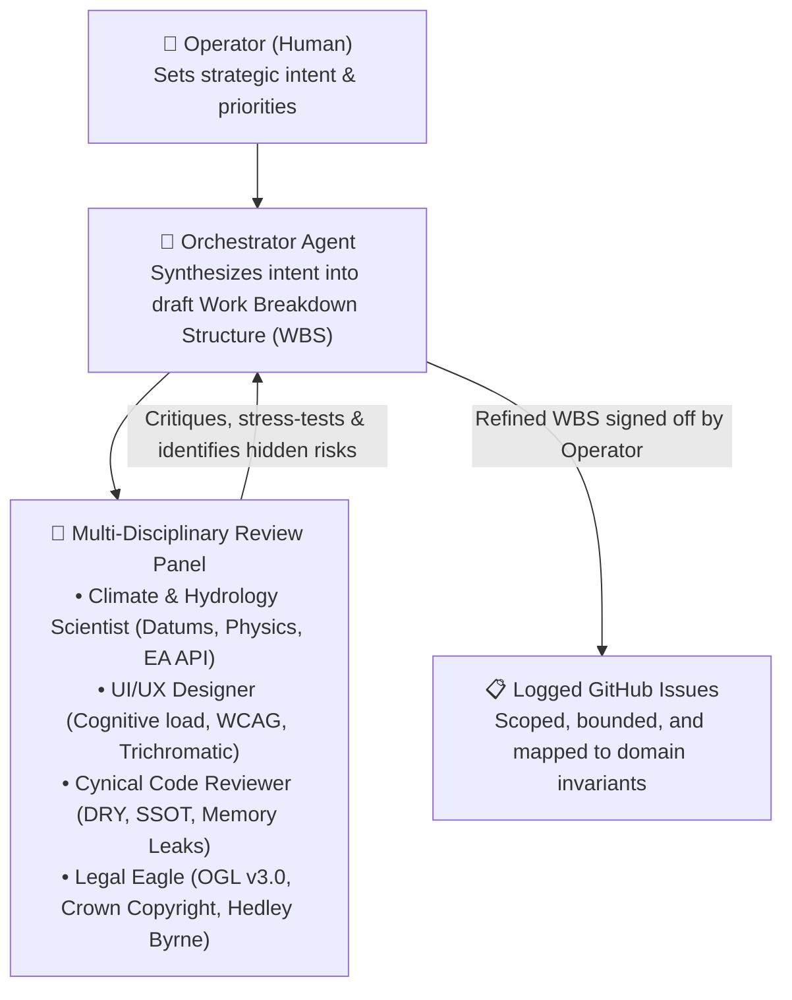
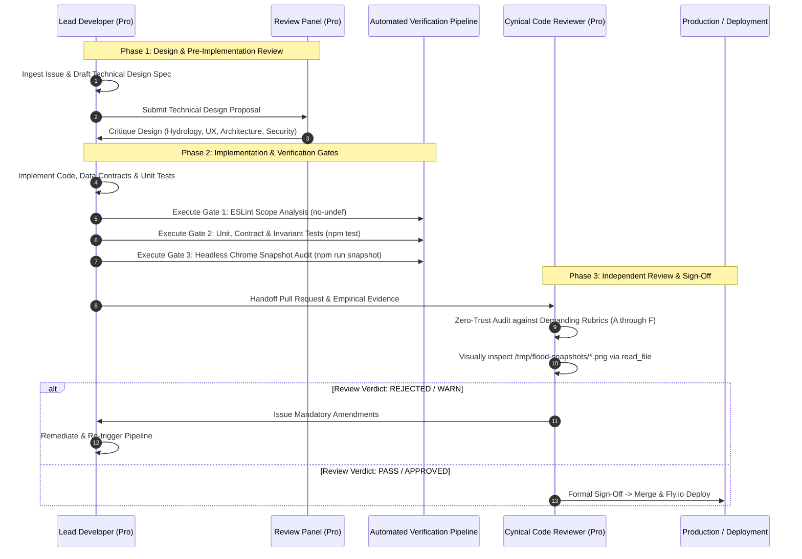

# Somerset Flood Telemetry: Engineering Process & Multi-Agent Governance

**Status:** Authoritative Engineering Governance Standard  
**Governing Rules:** `AGENTS.md` (`[RULE-MOD-01]`, `[RULE-HUM-01]`, `[RULE-CALC-01]`, `[RULE-ENT-01]`, `[RULE-PROC-01]`, `[RULE-SSOT-01]`, `[UI-VIS-01]`)  
**Scope:** Work breakdown planning, issue management, technical design, implementation, and zero-trust verification.

---

## 1. Operating Philosophy: Separation of Duties & Epistemic Humility

In this civic life-safety telemetry platform, **no single agent operates without independent checks and balances**:
- The **Lead Developer** writes features and bugfixes but is **strictly forbidden from reviewing or approving its own work**.
- The **Review Panel** operates with zero trust: code is assumed to contain latent defects, physical falsehoods, memory leaks, or accessibility regressions until empirically proven otherwise.
- The **Human Operator** holds supreme executive governance over priority, scope, and public transparency.

---

## 2. Macro-Level Lifecycle: Work Breakdown Structure (WBS) & Inception

Before code is written, feature requests and architectural milestones progress through the collaborative planning loop:

1. **Strategic Intent:** The human operator identifies platform needs (e.g. monetization, national brand migration, highway passability).
2. **Draft WBS Synthesis:** The orchestrator translates intent into discrete work packages, identifying dependencies, risks, and required invariants.
3. **Review Panel Critique:** Specialized domain subagents (`Model: 'pro'`) critique the draft:
   - *Hydrology:* Verifies mAOD datums, 5-class taxonomy, and downhill hydraulic invariants.
   - *UI/UX:* Evaluates visual hierarchy, color safety zones (`[UI-COL-01]`), and interactive scrubbing.
   - *Cynical Auditor:* Enforces single source of truth (`[RULE-SSOT-01]`), DRY layout architecture, and state lifecycle.
   - *Legal:* Verifies OGL v3.0 licensing compliance, Crown copyright attribution, and disclaimer shielding.
4. **Issue Creation:** The orchestrator logs unambiguous, well-scoped GitHub issues containing clear acceptance criteria.

---

## 3. Micro-Level Lifecycle: Feature & Issue Execution Pipeline

Every GitHub issue progresses through a mandatory 5-gate pipeline:

### Gate 1: Issue Ingestion & Invariant Scoping
- The developer reviews the issue, identifies relevant physical invariants (`[RULE-HUM-01]` through `[RULE-ENT-01]`), and checks whether the change involves a prototype or core system.

### Gate 2: Technical Design & Architecture Proposal
- Before writing production code, the developer produces a design spec covering data contracts, layout partials, state lifecycle, and error boundaries.

### Gate 3: Review Panel Design Critique
- The design is stress-tested by the review panel. If the design introduces uncalibrated estimates, cumec calculations, duplicated HTML chrome, or inaccessible touch targets, it is rejected before implementation begins.

### Gate 4: Implementation & Automated Verification Gates
- Code is written under strict constraints:
  - **Contract Boundary:** Ingestion and API endpoints must validate schemas via `src/js/contracts/` (`[ARCH-DATA-01]`).
  - **Presentation DRY:** Shared layout shells must use server partials or template injection (`[ARCH-VIEW-01]`).
  - **State Lifecycle:** Controllers must manage timers defensively (`[ARCH-CTRL-01]`).
- The developer must pass all automated verification gates:
  1. *Static Scope Analysis:* `npm run lint` (`eslint` with `no-undef`).
  2. *Unit & Contract Suite:* `npm test` (all tests passing with 0 failures).
  3. *Empirical Snapshot Suite:* `npm run snapshot` (Headless Chromium driving `/usr/bin/google-chrome` with 0 console errors and verified DOM node assertions).

### Gate 5: Independent Cynical Code Review
- The Cynical Reviewer reviews the PR with zero trust, verifies test outputs, inspects screenshots via `read_file`, and issues a structured **PASS / FAIL / WARN** report.

---

## 4. Retrospective Loop: Incident-Driven Governance

When defects, omissions, or process gaps escape into the codebase, the team executes a **Retrospective Conversion**:
1. **Never rely on human memory or goodwill:** If a failure mode occurred, it was because a structural gate was missing.
2. **Convert failures into automated gates:**
   - *Example 1 (Silent runtime crash):* Headless Chrome CLI exited 0 on an empty DOM $\to$ Implemented Puppeteer console error trapping and DOM node count assertions in `capture_views.js`.
   - *Example 2 (Scope reference error):* Undeclared variable crashed runtime $\to$ Chained ESLint `no-undef` into `npm test`.
   - *Example 3 (400-line DRY violation):* Reviewer missed duplicated HTML because it checked diff consistency $\to$ Codified `[ARCH-VIEW-01]` in `ARCHITECTURAL_PRINCIPLES.md` and added an HTML Markup DRY gate to `SKILL.md`.
