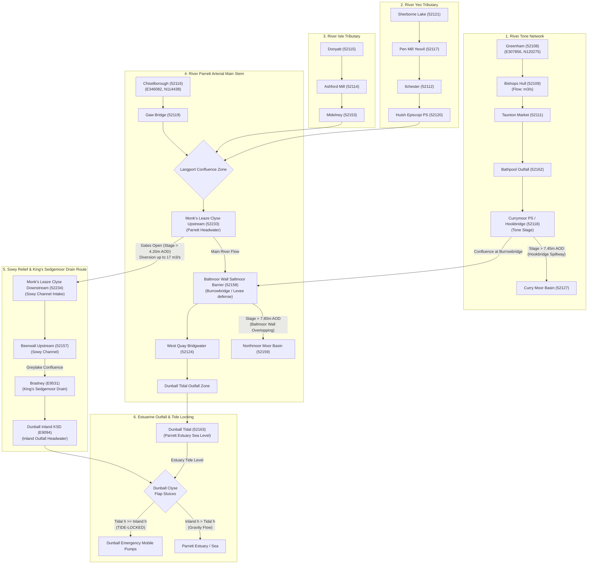

# End-to-End Hydrological Flow Network & Topology Report: Somerset Levels & Moors

**Author:** Climate & Hydrology Scientist (`climate_hydrology_scientist`)  
**Date:** September 12, 2026  
**Data Source:** `scripts/full_river_network.json` & Environment Agency Real-Time Telemetry Network  
**Target File:** `docs/full_river_network_topology.md`  

---

## Executive Summary

The Somerset Levels and Moors comprise an intricately engineered lowland drainage basin covering approximately 650 square kilometers in South West England. Hydrologically, the region is characterized by flat, sub-sea-level embanked moors, multi-river confluences, tide-locked estuarine outlets, and artificial relief diversion channels. Managing flood risk requires continuous telemetry monitoring of stage elevations, flow rates, sluice gate status, gravity spillways, and land drainage pumping stations across the primary arterial rivers (River Tone, River Parrett, River Yeo, and River Isle) and artificial conveyance structures (Sowy Relief Channel and King's Sedgemoor Drain).

This report presents an end-to-end hydrological flow network analysis based on the complete multi-river network dataset in `scripts/full_river_network.json`. It documents exact upstream-to-downstream station sequences, geodetic coordinates (Latitude/Longitude and Ordnance Survey Easting/Northing), inter-river tributary linkages, hydraulic relief conveyance routes, and structural spillway operating elevations.

---

## 1. River Tone Hydrological Sequence

The River Tone originates in the Brendon Hills and flows eastward through Wellington and Taunton before entering the Somerset Levels at Curry Moor, eventually terminating at its confluence with the River Parrett at Burrowbridge (Athelney).

### Upstream-to-Downstream Station Sequence:

```
[52108] Greenham (Upper Tone)
       │
       ▼
[52109] Bishops Hull (Mid Tone / Flow Monitoring)
       │
       ▼
[52111] Taunton Market (Urban Taunton Stage)
       │
       ▼
[52162] Bathpool Outfall (Lower Tone / Canal Interchange)
       │
       ▼
[52118] Currymoor Pumping Station / Hookbridge (Lowland Tone / Spillway Elevation)
       │
       └─► Confluence with River Parrett at Burrowbridge / Stanmoor
```

### Detailed Station Description & Hydraulic Role:
1. **Greenham (`52108`)**: Upper rural catchment monitoring station located west of Wellington. Serves as the primary early warning gauge for upland flash runoff entering the Tone from the Brendon Hills.
2. **Bishops Hull (`52109`)**: Core arterial flow and stage monitoring site immediately west of Taunton. Records continuous volumetric flow rate ($m^3/s$) and stage elevation ($m$), providing critical input data for downstream urban flood routing.
3. **Taunton Market (`52111`)**: Central urban stage gauge recording water surface elevation through the bottleneck of Taunton town center.
4. **Bathpool Outfall (`52162`)**: Dual-stage sensor monitoring the downstream reach of the Tone as it leaves Taunton and interfaces with the Bridgwater and Taunton Canal overflow.
5. **Currymoor Pumping Station / Hookbridge (`52118`)**: Critical lowland arterial stage sensor located co-adjacent to the engineered **Hookbridge Gravity Spillway** ($Z_{\text{crest}} = 7.45\text{ m AOD}$). When stage at `52118` exceeds $7.45\text{ m AOD}$, floodwaters spill over Hookbridge into the embanked Curry Moor & Hay Moor basin (`52127`).

---

## 2. River Parrett Hydrological Sequence

The River Parrett is the main arterial river of the catchment, flowing north-northwest from its headwaters in Dorset through South Somerset, past Langport and Bridgwater, before discharging into the Bristol Channel via the macro-tidal Parrett Estuary at Dunball.

### Upstream-to-Downstream Station Sequence:

```
[52116] Chiselborough (Upper Parrett Upland Reach)
       │
       ▼
[52119] Gaw Bridge (Mid Parrett Floodplain Reach)
       │
       ▼  ◄── [Confluence: River Yeo (52120) & River Isle (52153)]
[52233] Monk's Leaze Clyse Upstream (Langport / Headwater Diversion Control)
       │
       ├─► [Diversion into Sowy Relief Channel via Sluice Gates (52234)]
       ▼
[52158] Baltmoor Wall Saltmoor Barrier (Tone/Parrett Confluence & Levee Defense)
       │
       ▼
[52124] West Quay Bridgwater (Tidal Transition Reach)
       │
       ▼
[52163] Dunball Tidal (Parrett Estuary Terminal Sea Outfall)
```

### Detailed Station Description & Hydraulic Role:
1. **Chiselborough (`52116`)**: Upland rural catchment gauge capturing upper headwater discharge from the chalk hills of Dorset/Somerset border.
2. **Gaw Bridge (`52119`)**: Mid-reach stage gauge in Kingsbury Episcopi monitoring broad floodplain flow prior to major tributary confluences.
3. **Monk's Leaze Clyse Upstream (`52233`)**: Critical diversion control gauge on the River Parrett upstream of Langport. Measures headwater stage prior to the **Monk's Leaze Clyse Sluice Structure**. When Parrett stage exceeds $4.20\text{ m AOD}$, EA operators raise gates to divert up to $17.0\text{ m}^3/s$ into the Sowy Relief Channel (`52234`).
4. **Baltmoor Wall Saltmoor Barrier (`52158`)**: High-priority levee stage sensor co-located along **Baltmoor Wall** ($Z_{\text{crest}} = 7.80\text{ m AOD}$) downstream of the Tone/Parrett confluence at Burrowbridge. Protects Northmoor (`52159`) from arterial overtopping.
5. **West Quay Bridgwater (`52124`)**: Tidal-river transition sensor located in urban Bridgwater, monitoring macro-tidal surges propagating upstream from Bridgwater Bay.
6. **Dunball Tidal (`52163`)**: Estuarine marine tide gauge situated outside Dunball Clyse on the Parrett Estuary. Records extreme tidal oscillations (up to $7.094\text{ m AOD}$) governing tide-locking of the King's Sedgemoor Drain.

---

## 3. Major Tributary Networks Feeding the Parrett

The River Parrett receives inflow from two major upland tributary systems—the **River Yeo** and the **River Isle**—which join the main stem near Langport.

### A. River Yeo Sequence

The River Yeo drains the eastern sector of the catchment (including Yeovil and Sherborne) and flows westward into the Parrett at Huish Episcopi / Langport.

```
[52121] Sherborne Lake (Upper Yeo Headwater Reservoir)
       │
       ▼
[52117] Pen Mill (Yeovil Urban Flow Reach)
       │
       ▼
[52112] Ilchester (Mid Yeo Floodplain Gauge)
       │
       ▼
[52120] Huish Episcopi Pumping Station (Terminal Yeo Gauge / Parrett Confluence)
       │
       └─► Confluence into River Parrett upstream of Langport
```

1. **Sherborne Lake (`52121`)**: Headwater lake/reservoir stage gauge monitoring storage in upper Dorset headwaters.
2. **Pen Mill (`52117`)**: Primary urban stage gauge for Yeovil.
3. **Ilchester (`52112`)**: Mid-reach stage gauge monitoring low-gradient floodplain flow.
4. **Huish Episcopi Pumping Station (`52120`)**: Terminal Yeo gauge co-located with Huish Episcopi land drainage pumps near the confluence with the Parrett.

### B. River Isle Sequence

The River Isle drains the southern sector of the catchment (Chard and Ilminster) and flows northeast to join the Parrett at Midelney, just south of Langport.

```
[52115] Donyatt (Upper Isle Gauge)
       │
       ▼
[52114] Ashford Mill (Ilton / Mid Isle Gauge)
       │
       ▼
[52153] Midelney (Terminal Isle Gauge / Parrett Confluence)
       │
       └─► Confluence into River Parrett south of Langport
```

1. **Donyatt (`52115`)**: Upper catchment gauge near Ilminster recording rapid runoff from the Blackdown Hills.
2. **Ashford Mill (`52114`)**: Mid-reach stage sensor near Ilton.
3. **Midelney (`52153`)**: Terminal stage sensor monitoring Isle discharge immediately prior to entering the River Parrett at Midelney Sluice.

### C. River Cary & Lowland Drain Interchange
- **Long Load (`52156`)**: Located on the Witcombe Bottom Main Drain / River Cary lower diversion reach ($51.010875, -2.758978$), monitoring water levels in the King's Sedgemoor southern boundary rhyne system.

---

## 4. King's Sedgemoor Drain & Sowy Relief Channel Conveyance Path

The **Sowy Relief Channel** (River Sowy) and **King's Sedgemoor Drain (KSD)** constitute an engineered dual-bypass conveyance corridor designed to divert high flood flows away from the vulnerable Tone/Parrett confluence at Burrowbridge and route them directly to the sea at Dunball.

### Complete Diversion & Conveyance Sequence:

```
                       [RIVER PARRETT]
                              │
                              ▼
           [52233] Monk's Leaze Clyse Upstream (Intake)
                              │
               (Sluice Gate Diversion: Stage > 4.20m AOD)
                              │
                              ▼
           [52234] Monk's Leaze Clyse Downstream (Sowy Head)
                              │
                              ▼  (Sowy Relief Channel - 14 km engineered bypass)
           [52157] Beerwall Upstream (Othery / Sowy Mid-reach)
                              │
                              ▼  (Sowy discharges into King's Sedgemoor Drain at Greylake)
           [E9531] Bradney (King's Sedgemoor Drain Mid-reach)
                              │
                              ▼  (KSD Inland Terminal Channel)
           [E9094] Dunball Inland (KSD Flap Sluice Headwater)
                              │
              ┌───────────────┴───────────────┐
              ▼                               ▼
     [Gravity Discharge]             [TIDE-LOCKED STATE]
  (Inland h_E9094 > Tidal h_52163)  (Tidal h_52163 >= Inland h_E9094)
              │                               │
              ▼                               ▼
   Flap Gates Swing Open           Flap Gates Passive Close;
   Flow to Parrett Estuary         High-Capacity Mobile Pumps Active
              │                               │
              └───────────────┬───────────────┘
                              ▼
              [52163] Dunball Tidal (Parrett Estuary)
```

### Conveyance Mechanism & Operational Logic:
1. **Intake Diversion (`52233` ➔ `52234`)**: When River Parrett stage at `52233` exceeds $4.20\text{ m AOD}$, Monk's Leaze Clyse gates are raised. Differential head $\Delta h = h_{52233} - h_{52234}$ dictates the volumetric diversion rate into the Sowy Relief Channel (up to $17.0\text{ m}^3/s$).
2. **Sowy Channel Transit (`52157`)**: Water flows north-northeast through the Sowy Relief Channel, past Beer Wall (`52157`), bypassing Burrowbridge and Curry Moor.
3. **KSD Confluence (`E9531`)**: The Sowy discharges into the King's Sedgemoor Drain at Greylake. Water travels northwest along the KSD past Bradney (`E9531`).
4. **Outfall Control & Tide Locking (`E9094` vs `52163`)**: Flow reaches the terminal inland outfall structure at Dunball (`E9094`).
   - **Gravity Outfall Mode**: When inland level $h_{\text{E9094}} > h_{52163}$ (low tide), tide flap sluices swing open automatically, discharging water into the Parrett Estuary (`52163`).
   - **Tide-Locked Mode**: When estuarine tide $h_{52163} \ge h_{\text{E9094}}$ (high spring tide), backpressure closes the flap sluices tightly. Gravity discharge stops, and emergency mobile pumps at Dunball must be operated to maintain inland drainage capacity.

---

## 5. Master Coordinates & Hydrographic Metadata Table

The following table provides the exact geodetic coordinates (WGS84 Latitude/Longitude and OSGB36 Easting/Northing), grid references, and monitoring parameters for every station across all river sequences in the multi-river dataset (`scripts/full_river_network.json`).

| Station ID | Station Name | River / Watercourse | Town / Location | Latitude (°N) | Longitude (°E) | Easting (m) | Northing (m) | Grid Reference | Monitored Parameters & Units |
| :--- | :--- | :--- | :--- | :--- | :--- | :--- | :--- | :--- | :--- |
| **52108** | Greenham | River Tone | Greenham | 50.974487 | -3.313793 | 307856 | 120275 | N/A | Water Level (Stage: m, mASD) |
| **52109** | Bishops Hull | River Tone | Bishops Hull | 51.019081 | -3.133644 | 320580 | 125024 | N/A | Flow ($m^3/s$), Water Level (Stage: m, mASD) |
| **52111** | Taunton Market | River Tone | Taunton Market | 51.020017 | -3.100618 | 322898 | 125093 | ST2291325093 | Water Level (Stage: m, mASD) |
| **52162** | Bathpool Outfall | River Tone | Bathpool | 51.025799 | -3.066732 | 325284 | 125701 | ST2528425701 | Water Level (Stage: m, mAOD; Downstage: m) |
| **52118** | Currymoor Pumping Station | River Tone | Athelney | 51.054966 | -2.936065 | 334489 | 128820 | N/A | Water Level (Stage: mAOD, mASD) |
| **52116** | Chiselborough | River Parrett | Chiselborough | 50.926860 | -2.768537 | 346082 | 114438 | N/A | Water Level (Stage: m, mASD) |
| **52119** | Gaw Bridge | River Parrett | Kingsbury Episcopi | 50.976043 | -2.793549 | 344383 | 119926 | N/A | Water Level (Stage: mASD) |
| **52233** | Monk's Leaze Clyse (Upstream) | River Parrett | Langport | 51.044626 | -2.843820 | 340941 | 127592 | ST4094127592 | Water Level (Stage: mAOD, mASD) |
| **52158** | Baltmoor Wall Saltmoor Barrier | Saltmoor Main Drain | East Lyng | 51.059531 | -2.940994 | 334150 | 129332 | ST3415029332 | Water Level (Stage: mAOD, mASD) |
| **52124** | West Quay | River Parrett | Bridgwater | 51.129895 | -3.001618 | 330008 | 137213 | N/A | Water Level (Stage: m, mASD) |
| **52163** | Dunball Tidal | River Parrett | Dunball | 51.162253 | -2.989562 | 330900 | 140800 | ST3090040800 | Water Level (Tidal Level: mAOD, mASD) |
| **52121** | Sherborne Lake | River Yeo | Sherborne | 50.947873 | -2.503101 | 364753 | 116614 | N/A | Water Level (Stage: mASD) |
| **52117** | Pen Mill | River Yeo | Yeovil | 50.943504 | -2.608654 | 357334 | 116184 | N/A | Water Level (Stage: m, mASD) |
| **52112** | Ilchester | River Yeo | Ilchester | 51.003358 | -2.683234 | 352156 | 122886 | N/A | Water Level (Stage: m, mASD) |
| **52120** | Huish Episcopi Pumping Station | River Yeo | Huish Episcopi | 51.031669 | -2.798991 | 344068 | 126116 | N/A | Water Level (Stage: mASD) |
| **52115** | Donyatt | River Isle | Donyatt | 50.921842 | -2.940546 | 333986 | 114020 | N/A | Water Level (Stage: m, mASD) |
| **52114** | Ashford Mill | River Isle | Ilton | 50.964926 | -2.912024 | 336050 | 118786 | N/A | Water Level (Stage: m, mASD) |
| **52153** | Midelney | River Isle | Langport | 51.008129 | -2.832096 | 341717 | 123524 | ST4171223517 | Water Level (Stage: mASD) |
| **52156** | Long Load | Witcombe Bottom Main Drain | Long Load | 51.010875 | -2.758978 | 346850 | 123774 | ST4685023774 | Water Level (Stage: mASD) |
| **52234** | Monk's Leaze Clyse (Downstream) | Sowy Relief Channel | Langport | 51.044626 | -2.843820 | 340941 | 127592 | ST4094127592 | Water Level (Downstage: mAOD, mASD) |
| **52157** | Beerwall Upstream | River Sowy | Othery | 51.079805 | -2.869413 | 339193 | 131525 | ST3919331525 | Water Level (Stage: mAOD, mASD) |
| **E9531** | Bradney | Kings Sedgemoor Drain | Bradney Bridgwater | 51.148548 | -2.945191 | 333983 | 139235 | ST3398339235 | Water Level (Stage: mAOD, mASD) |
| **E9094** | Dunball | Kings Sedgemoor Drain | Bridgwater | 51.161484 | -2.988087 | 331002 | 140713 | ST3100240713 | Water Level (Stage: m, mAOD) |

---

## 6. Comprehensive Hydrological Network Flow Diagram

The following Mermaid diagram visualizes the complete multi-river topology, linking headwaters, tributaries, spillways, diversion channels, moor basins, and sea outfalls.



---

## 7. Key Hydrological & Hydraulic Findings

1. **Topological Order & Flow Direction:**
   - The **River Tone** flows east-northeast from Greenham (`52108`, Northing: $120275$) to Athelney (`52118`, Northing: $128820$).
   - The **River Parrett** flows north-northwest from Chiselborough (`52116`, Northing: $114438$) to Dunball (`52163`, Northing: $140800$).
   - The **River Yeo** flows west from Sherborne (`52121`, Easting: $364753$) to Langport (`52120`, Easting: $344068$).
   - The **River Isle** flows northeast from Donyatt (`52115`, Easting: $333986$) to Midelney (`52153`, Easting: $341717$).

2. **Engineered Relief Bypassing:**
   - The **Sowy Relief Channel** serves as an artificial safety valve. Diverting high flows at Monk's Leaze Clyse (`52233`/`52234`) bypasses the sensitive Tone/Parrett confluence at Burrowbridge (`52118`/`52158`), alleviating pressure on Baltmoor Wall.

3. **Spillway Overtopping & Basin Storage:**
   - **Hookbridge Spillway** ($Z_{\text{crest}} = 7.45\text{ m AOD}$): Controlled overtopping from River Tone (`52118`) fills Curry Moor (`52127`).
   - **Baltmoor Wall** ($Z_{\text{crest}} = 7.80\text{ m AOD}$): Defends Northmoor (`52159`). Overtopping represents catastrophic levee breach or extreme overflow risk.

4. **Tide-Locking Dynamics at Dunball:**
   - The terminal sea outfall at Dunball relies on passive hydraulic flap sluices. High estuarine spring tides at `52163` exceeding the inland KSD stage at `E9094` cause immediate tide-locking, halting gravity discharge for 4–6 hours per tide cycle and necessitating high-capacity mobile pumping operations.
