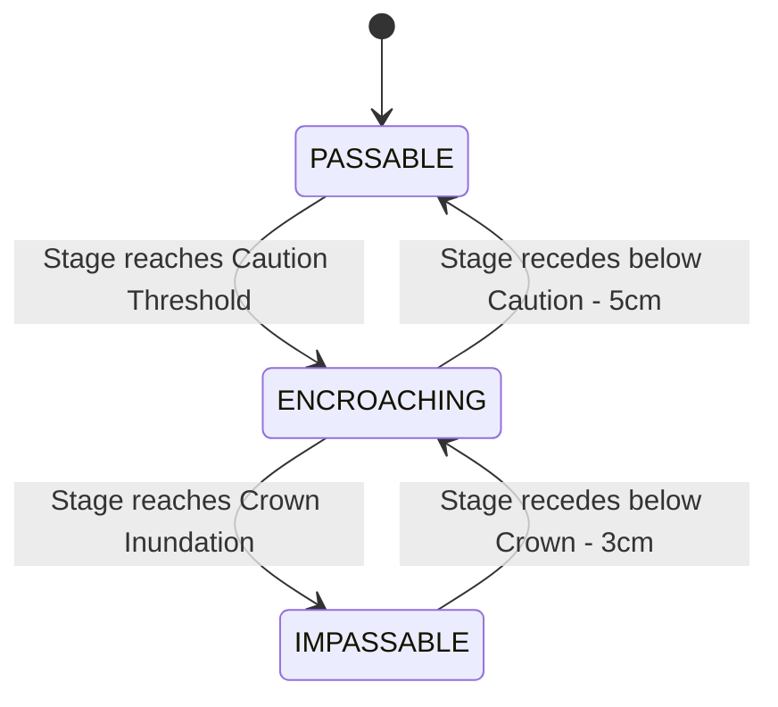
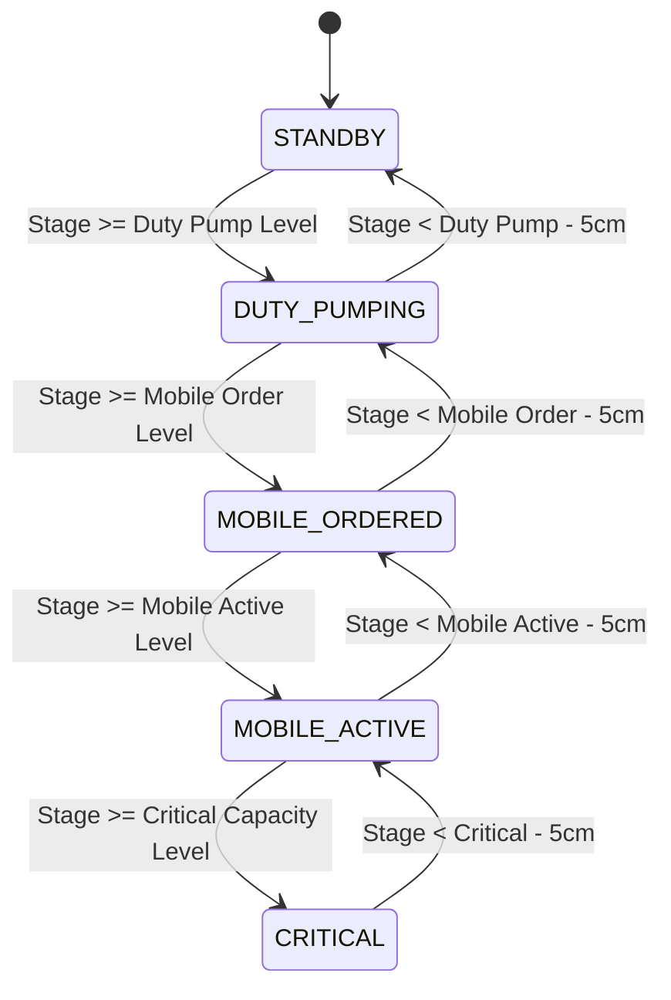
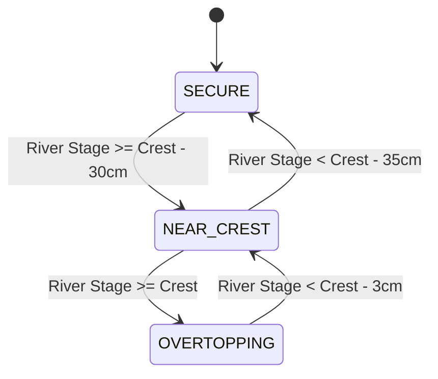
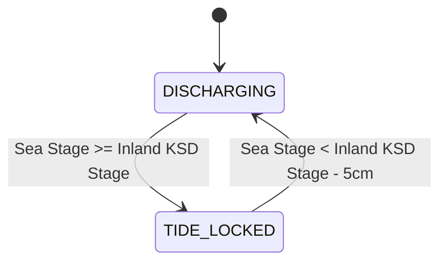

# Hydrological Event Matrix & State Transition Specification
## Somerset Levels & Moors Flood Telemetry Network

**Role:** Lead Climate & Hydrology Scientist (`climate_hydrology_scientist`) & Technical Auditor  
**Date:** October 2026  
**Status:** Authoritative Hydrological Domain Standard & System Architecture Specification (v2.0)  
**Governing Invariants:** `.agents/AGENTS.md` (`RULE-ALT-01..05`, `RULE-TAX-01..06`, `RULE-DAT-01..04`, `RULE-SLP-01..04`, `RULE-PUMP-01`, `RULE-NET-01`, `RULE-CALC-01`)  
**Hydrological References:** Environment Agency Somerset Levels Trigger Point Plan; EA Hydrometry & Telemetry Service; UK Geodetic Datum Newlyn (mAOD).  
**Target Subsystems:** `src/js/hydro_engine.js`, `server.js`, `telemetry.db` (`hydraulic_events`), Automated Event Engine, AI Vision Inspection Pipeline.

---

## 1. Architectural Invariants: Ground-Truth Stage vs. Volumetric Speculation

### 1.1 Strict Ban on Volumetric & Discharge Speculation (`[RULE-CALC-01]`)
Environment Agency real-time APIs provide **water stage ($m$)** at 15-minute intervals. The API does **NOT** provide:
- Open-channel river rating curves ($Q(h)$) or bathymetric cross-sections;
- Sluice gate aperture telemetry ($w$) at diversion structures like Monk's Leaze Clyse;
- Electrical SCADA run-state or power telemetry from internal drainage board pumping stations.

> [!IMPORTANT]
> **No Volumetric Calculus:** Calculating, integrating, or broadcasting volumetric flow rates ($m^3/s$, cumecs, Megalitres/day, or cumulative volume $m^3$) as ground-truth telemetry or database triggers is **STRICTLY PROHIBITED**.
> 
> The system tracks **what is empirically measured with confidence**: exact water stage elevation ($\text{mAOD}$), structural clearance ($\text{m}$ to crest or road crown), event duration ($h$), and discrete operational state transitions.

### 1.2 Normalized Entity-State Architecture (`[RULE-TAX-06]`)
All events must strictly adhere to normalized relational entity-state triples:
$$\langle \text{asset\_type}, \text{asset\_id}, \text{state} \rangle$$
Bespoke concatenated event names (such as `CUTS_ROAD_CASCADE_START` or `MUCHELNEY_ROAD_INUNDATION`) are **STRICTLY BANNED**. A road is an asset of type `road`, with standard states (`PASSABLE`, `ENCROACHING`, `IMPASSABLE`).

---

## 2. Canonical Asset Types & Normalized State Machines

```
┌─────────────────────────────────────────────────────────────────────────────┐
│                          5 CANONICAL ASSET TYPES                            │
├─────────────────────────────────────────────────────────────────────────────┤
│  1. road        🛣️ Community highway access & flood passability             │
│  2. polder      🚜 Lowland flood retention basin & EA pumping triggers     │
│  3. spillway    🌊 Engineered lateral overflow weir into retention moor     │
│  4. tidal_gate  🌊 Macro-tidal estuarine outfall with gravity flap doors    │
│  5. sluice      🎛️ Controlled river diversion structure (clyse)            │
└─────────────────────────────────────────────────────────────────────────────┘
```

---

### 2.1 Asset Type: `road` (Highway Passability & Public Access)
Tracks road crown inundation across vital Somerset Levels transport arteries.

| Asset ID (`asset_id`) | Monitored Highway | Driving Station | Critical Elevations (mAOD) |
| :--- | :--- | :---: | :--- |
| `cuts_road` | Cuts Road (East Lyng $\leftrightarrow$ Athelney) | `52127` (Curry Moor) | Crown: $7.35\text{m}$ (Athelney Spillway cascade)<br>Caution: $7.30\text{m}$ |
| `muchelney_access` | Muchelney Spine Road (Huish $\leftrightarrow$ Muchelney) | `52120` (River Yeo at Huish PS) | Low spot: $7.30\text{m}$<br>Cut-off: $7.70\text{m}$ |

#### State Machine:


- **`PASSABLE` (Severity 5 - Nominal):** Road is dry and open to standard vehicles.
- **`ENCROACHING` (Severity 4 - Caution):** Water is at road margins or shallow across low spots ("damp / splash caution"). Small car advisory.
- **`IMPASSABLE` (Severity 2 - Road Closed):** Active deep flowing water across road crown. Road closed; tractor shuttle / emergency detour required.

---

### 2.2 Asset Type: `polder` (Lowland Storage Moors & Pumping Sequencing)
Governed strictly by the **Environment Agency Somerset Levels Trigger Point Plan** (`[RULE-PUMP-01]`).

| Asset ID (`asset_id`) | Polder Storage Basin | Primary Stations | Fixed Duty Pumps (W / S) | Mobile Pumps Ordered | Mobile Pumps Active | Critical Capacity Risk |
| :--- | :--- | :---: | :---: | :---: | :---: | :---: |
| `curry_moor` | Curry Moor Storage Basin | `52127` | $4.30\text{m} / 4.60\text{m}$ | **$5.80\text{m AOD}$** | **$6.10\text{m AOD}$** | **$6.50\text{m AOD}$** |
| `northmoor` | Northmoor Retention Basin | `52159` | $3.70\text{m} / 3.90\text{m}$ | **$4.80\text{m AOD}$** | **$5.20\text{m AOD}$** | **$5.60\text{m AOD}$** |

#### State Machine:


- **`STANDBY` (Severity 5 - Nominal):** Basin levels within routine ecological/agricultural penning envelope.
- **`DUTY_PUMPING` (Severity 5 - Operational):** Permanent IDB/EA station pumps running under automated duty cycle.
- **`MOBILE_ORDERED` (Severity 4 - Logistical Alert):** High-volume trailer-mounted temporary pumps ordered from depot by EA.
- **`MOBILE_ACTIVE` (Severity 3 - Emergency Operations):** Emergency mobile pumps deployed and operating at station outfall.
- **`CRITICAL` (Severity 1 - Severe Flood Threat):** Moor storage approaching structural levee capacity. Overspill / evacuation risk.

---

### 2.3 Asset Type: `spillway` (Engineered Levee Overflow Weirs)
Lateral relief structures designed to skim excess river flood peaks into adjacent storage basins.

| Asset ID (`asset_id`) | Physical Structure | Upstream River Station | Downstream Receiving Basin | Surveyed Crest ($Z_{\text{crest}}$) |
| :--- | :--- | :---: | :---: | :---: |
| `hookbridge` | Hookbridge Spillway | `52118` (River Tone) | `52127` (Curry Moor) | **$7.45\text{m AOD}$** |
| `baltmoor_wall` | Baltmoor Wall Levee Barrier | `52158` (Tone/Parrett Confluence) | `52159` (Northmoor) | **$7.80\text{m AOD}$** |
| `beer_wall` | Beer Wall Sluice Spillway | `52157` (Sowy Bypass) | King's Sedgemoor Drain | **$7.30\text{m AOD}$** |

#### State Machine:


- **`SECURE` (Severity 5 - Safe):** River is $> 30\text{cm}$ below concrete weir crest.
- **`NEAR_CREST` (Severity 4 - Pre-Warning):** River is within $30\text{cm}$ of weir lip. Bankfull capacity imminent.
- **`OVERTOPPING` (Severity 2 - Active Spill):** River stage $\ge Z_{\text{crest}}$. Active flow cascading over weir into retention moor.

---

### 2.4 Asset Type: `tidal_gate` (Macro-Tidal Sea Outfalls)
Automatic gravity tidal flap clyses discharging inland drainage into the macro-tidal Bristol Channel / Parrett Estuary.

| Asset ID (`asset_id`) | Physical Asset | Estuary Station | Inland Drain Station | Nominal Regime |
| :--- | :--- | :---: | :---: | :---: |
| `dunball_outfall` | Dunball Sea Doors (KSD Clyse) | `52163` (Parrett Estuary) | `E9094` (Inland KSD) | Gravity discharge during low tide |

#### State Machine:


- **`DISCHARGING` (Severity 5 - Nominal / Secure):** Low tide in estuary ($h_{\text{sea}} < h_{\text{inland}}$). Gravity flap gates swing open; inland drainage evacuates freely into sea. Styled strictly in Estuarine Deep Blue (`#0284c7`).
- **`TIDE_LOCKED` (Severity 4 - Restricted):** Rising tide in estuary ($h_{\text{sea}} \ge h_{\text{inland}}$). External seawater forces heavy flap gates shut against masonry seats. Gravity discharge completely halted.

---

### 2.5 Asset Type: `sluice` (Controlled Diversion Penstocks)
Manually or electrically operated sluice gates controlling gravity diversions between arterial channels.

| Asset ID (`asset_id`) | Sluice Structure | Intake River | Diversion Channel | Sill Elevation |
| :--- | :--- | :---: | :---: | :---: |
| `monks_leaze_clyse` | Monk's Leaze Clyse Intake | `52233` (Parrett) | `52234` (Sowy Relief Channel) | **$4.20\text{m AOD}$** |

#### State Machine:
Evaluation priority:
1. **`REVERSE_LOCK` (Severity 2):** $h_{\text{down}} \ge h_{\text{up}}$. Downstream channel higher than river intake. Sluices sealed to prevent backflow.
2. **`THROTTLED` (Severity 3):** River stage $\ge 4.20\text{m}$ and ($0.05\text{m} < \Delta H \le 0.10\text{m}$ OR $h_{\text{down}} \ge 7.60\text{m}$). Diversion restricted due to high downstream tailwater.
3. **`DIVERTING` (Severity 4 - Active Diversion):** River stage $\ge 4.20\text{m}$ and $\Delta H > 0.10\text{m}$ and $h_{\text{down}} < 7.60\text{m}$. Gate open, gravity flood relief active.
4. **`CLOSED` (Severity 5 - Nominal Penning):** River stage $< 4.20\text{m}$ OR ($h_{\text{up}} > h_{\text{down}}$ and $\Delta H \le 0.05\text{m}$). Gates down in normal agricultural penning mode.

---

## 3. Physical Anti-Flapping Hysteresis Deadbands (`HYDRO_DEADBANDS`)

To eliminate rapid event toggling from minor wind ripples, vessel wakes, and 15-minute sensor jitter, all state exits enforce calibrated physical deadbands exported centrally in `src/js/hydro_engine.js`:

```javascript
export const HYDRO_DEADBANDS = {
  weir_crest: 0.03,    // 3cm weir crest overtopping exit
  pre_spill: 0.05,     // 5cm approaching buffer exit
  polder_pump: 0.05,   // 5cm pumping station deactivation
  road_crown: 0.03,    // 3cm road inundation clearance exit
  road_caution: 0.05,  // 5cm road caution margin exit
  clyse_head: 0.05,    // 5cm dual-gauge differential head (exceeds 2-sigma combined sensor noise)
  tidal_flap: 0.05,    // 5cm sea flap cracking head differential
  river_gauge: 0.05    // 5cm in-channel flood alert clearance
};
```

> [!IMPORTANT]
> **Directional Rule:** Hysteresis deadbands apply **strictly on the exit/falling leg**. Rising triggers are physically exact ($h \ge h_{\text{threshold}}$).

---

## 4. SQLite Event Ledger Schema (`hydraulic_events`)

The event ledger in `telemetry.db` uses a clean, normalized schema:

```sql
CREATE TABLE IF NOT EXISTS hydraulic_events (
  id INTEGER PRIMARY KEY AUTOINCREMENT,
  asset_type TEXT NOT NULL CHECK(asset_type IN ('road', 'polder', 'spillway', 'tidal_gate', 'sluice')),
  asset_id TEXT NOT NULL,
  from_state TEXT,
  to_state TEXT NOT NULL,
  start_time TEXT NOT NULL,                    -- ISO 8601 UTC timestamp
  end_time TEXT,                              -- NULL while event is ACTIVE
  duration_seconds INTEGER,                   -- Populated on event closure
  trigger_stage_mAOD REAL NOT NULL,          -- Stage that tripped the threshold
  peak_stage_mAOD REAL NOT NULL,             -- Maximum water elevation during event
  structure_clearance_m REAL,                -- Clearance to crest or road crown
  severity INTEGER NOT NULL CHECK(severity BETWEEN 1 AND 5),
  camera_id TEXT,                            -- Correlated ground-truth webcam
  image_hash TEXT,                           -- SHA-256 hash of captured verification frame
  camera_snapshot_id INTEGER,                -- FK to camera_analysis record
  notes TEXT,                                -- Human-readable community explanation
  status TEXT NOT NULL CHECK(status IN ('ACTIVE', 'CLOSED', 'OCCURRED'))
);

CREATE INDEX IF NOT EXISTS idx_hydraulic_events_active 
  ON hydraulic_events(asset_id, status);

CREATE INDEX IF NOT EXISTS idx_hydraulic_events_start 
  ON hydraulic_events(start_time DESC);
```

---

## 5. Ground-Truth Camera Trigger Mapping

When high-severity events occur, the background poller dispatches an immediate webcam frame grab (subject to a 300-second rate-limiting cooldown per camera):

| Asset ID (`asset_id`) | Event Trigger State | Correlated Camera (`camera_id`) | Camera Location & View |
| :--- | :--- | :--- | :--- |
| `cuts_road` | `IMPASSABLE` | `athelney_cuts_rd` | Cuts Road across Athelney Spillway |
| `muchelney_access` | `IMPASSABLE` | `huish_episcopi` | River Yeo at Huish Episcopi / Muchelney (`#huish`) |
| `hookbridge` | `OVERTOPPING` | `hookbridge_spillway` | Hookbridge Weir crest & flow |
| `baltmoor_wall` | `OVERTOPPING` | `baltmoor_wall` | Baltmoor Wall armoring at Burrowbridge |
| `curry_moor` | `MOBILE_ACTIVE` | `currymoor_ps` | Currymoor Pumping Station outfall |
| `monks_leaze_clyse` | `DIVERTING` | `monks_leaze_clyse` | Monk's Leaze Clyse intake penstocks |
| `dunball_outfall` | `TIDE_LOCKED` | `dunball_clyse` | Dunball Sea Outfall flap doors & KSD |

---

## 6. Review & Architectural Compliance

This v2.0 specification fully supersedes the previous draft. It:
1. Enforces **`[RULE-CALC-01]`** by eliminating all speculative volumetric calculus and cumec formulas;
2. Enforces **`[RULE-TAX-06]`** by replacing bespoke concatenated strings with normalized `(asset_type, asset_id, state)`;
3. Elevates **roads and pumps** to first-class community life-safety entities;
4. Retains mathematically verified physical deadbands to prevent sensor flapping.
