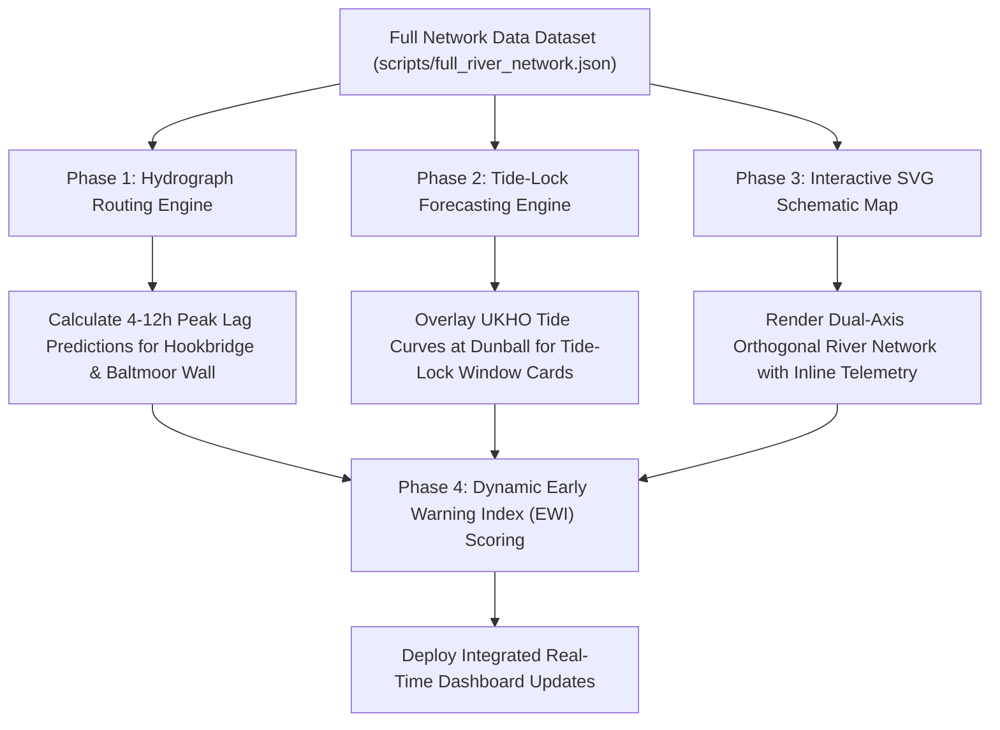

# Strategic Hydrological Modeling & Topological Feature Proposal: Somerset Levels & Moors

**Author:** Climate & Hydrology Scientist (`climate_hydrology_scientist`)  
**Date:** September 12, 2026  
**Data Basis:** `scripts/full_river_network.json` & `docs/full_river_network_topology.md`  
**Target Systems:** Somerset Levels Telemetry Dashboard (`floodtelemetry.uk` / `somerset-flood-dashboard`)

---

## Executive Summary

The complete river network topology dataset (`scripts/full_river_network.json` and `docs/full_river_network_topology.md`) captures 23 key telemetry stations across 5 main river corridors (River Tone, River Parrett, River Yeo, River Isle, and Sowy Relief / King's Sedgemoor Drain). This multi-river dataset enables a shift from reactive single-gauge threshold monitoring to **predictive hydrograph routing**, **estuarine tide-lock window forecasting**, **interactive schematic visualization**, and **real-time differential risk scoring**.

This report evaluates the proposed core ideas and details the mathematical models, empirical time lag metrics, topological SVG/Canvas schematic layout, and dynamic Early Warning Index (EWI) formulas required for implementation.

---

## 1. Hydrograph Routing & Peak Lag Forecasting

### 1.1 Hydrological Physics & Mathematical Routing Models

To transform upstream stage and flow telemetry into downstream arrival time predictions, we utilize a combined kinematic wave and Muskingum hydrograph routing framework.

#### A. Kinematic Wave Celerity & Travel Time
Wave celerity $c$ (the speed at which a flood crest propagates downstream) exceeds mean flow velocity $v$ in natural open channels. Under Manning's equation for a broad rectangular or trapezoidal channel:

$$c = \frac{dQ}{dA} = m \cdot v = \frac{5}{3} v$$

where $v = \frac{1}{n} R^{2/3} S_0^{1/2}$. The wave travel time $T_{\text{lag}}$ over reach length $L$ is:

$$T_{\text{lag}} = \frac{L}{c} = \frac{3 L}{5 v}$$

#### B. Muskingum Routing Equation
For downstream flow hydrograph $Q_{\text{out}}(t)$ prediction given upstream inflow $Q_{\text{in}}(t)$:

$$S = K \left[ x Q_{\text{in}} + (1 - x) Q_{\text{out}} \right]$$

In finite-difference time steps ($\Delta t = 15\text{ min}$):

$$Q_{\text{out}}^{t+1} = C_0 Q_{\text{in}}^{t+1} + C_1 Q_{\text{in}}^t + C_2 Q_{\text{out}}^t$$

where the routing coefficients are defined by reach travel time $K$ and weighting factor $x \approx 0.20\text{--}0.30$:

$$C_0 = \frac{\Delta t - 2Kx}{2K(1-x) + \Delta t}, \quad C_1 = \frac{\Delta t + 2Kx}{2K(1-x) + \Delta t}, \quad C_2 = \frac{2K(1-x) - \Delta t}{2K(1-x) + \Delta t}$$

---

### 1.2 Empirical Reach Distance & Peak Time Lag Matrix

Based on Ordnance Survey Easting/Northing coordinates from `scripts/full_river_network.json` and historical EA flood event wave speeds ($1.0\text{--}2.5\text{ m/s}$ in upper reaches; $0.4\text{--}0.8\text{ m/s}$ in lowland reaches):

```
===================================================================================================
UPSTREAM REGION                     TARGET DEFENSE / SPILLWAY        REACH DISTANCE  PEAK TIME LAG
===================================================================================================
River Tone:
  Greenham (52108)                 ──► Bishops Hull (52109)           ~13.2 km        1.5 - 2.5 hrs
  Bishops Hull (52109)             ──► Taunton Market (52111)         ~2.3 km         0.5 - 0.8 hrs
  Taunton Market (52111)           ──► Bathpool Outfall (52162)       ~2.4 km         0.5 - 0.7 hrs
  Bathpool Outfall (52162)         ──► Currymoor / Hookbridge (52118) ~9.7 km         3.0 - 4.5 hrs
  -------------------------------------------------------------------------------------------------
  CUMULATIVE TONE WARNING WINDOW: Greenham ➔ Hookbridge Spillway      ~27.6 km        5.5 - 8.5 HOURS EARLY WARNING!

River Parrett:
  Chiselborough (52116)            ──► Gaw Bridge (52119)             ~5.8 km         1.5 - 2.5 hrs
  Gaw Bridge (52119)               ──► Monk's Leaze Clyse (52233)     ~8.4 km         2.5 - 3.5 hrs
  River Yeo: Pen Mill (52117)      ──► Monk's Leaze Clyse (52233)     ~19.8 km        4.5 - 6.5 hrs
  River Isle: Donyatt (52115)      ──► Monk's Leaze Clyse (52233)     ~15.5 km        4.0 - 5.5 hrs
  Monk's Leaze Clyse (52233)       ──► Baltmoor Wall (52158)          ~6.9 km         2.5 - 4.0 hrs
  -------------------------------------------------------------------------------------------------
  CUMULATIVE PARRETT WARNING WINDOW: Upper Gauges ➔ Baltmoor Wall     ~21.1-34.1 km   6.5 - 12.0 HOURS EARLY WARNING!

Sowy Diversion & KSD Corridor:
  Monk's Leaze Clyse (52234)       ──► Beer Wall Sowy (52157)         ~4.3 km         1.0 - 1.5 hrs
  Beer Wall Sowy (52157)           ──► Bradney KSD (E9531)            ~9.4 km         2.5 - 3.5 hrs
  Bradney KSD (E9531)              ──► Dunball Inland KSD (E9094)     ~3.4 km         0.8 - 1.2 hrs
  -------------------------------------------------------------------------------------------------
  CUMULATIVE SOWY DIVERSION TRANSIT: Monk's Leaze ➔ Dunball Outfall   ~17.1 km        4.3 - 6.2 hrs
===================================================================================================
```

---

### 1.3 Predictive Spillway Overtopping & Basin Volume Formulas

#### A. Overtopping Onset Time Prediction
Using upstream rate-of-rise $\frac{dh_u}{dt}$ at Bishops Hull (`52109`) or Gaw Bridge (`52119`), predicted stage $h_{\text{predicted}}(t + T_{\text{lag}})$ at the spillway is:

$$h_{\text{predicted}}(t + T_{\text{lag}}) = h_{\text{current\_down}}(t) + \alpha \cdot \left(\frac{dh_{\text{up}}}{dt}\right) \cdot T_{\text{lag}}$$

where $\alpha \approx 0.85\text{--}0.95$ accounts for channel storage attenuation. Time until overtopping onset ($t_{\text{overtop}}$):

$$t_{\text{overtop}} = \frac{Z_{\text{crest}} - h_{\text{current\_down}}}{\alpha \cdot (dh_{\text{up}}/dt)}$$

#### B. Free Overtopping Discharge (Unsubmerged Weir)
When river stage exceeds spillway crest ($h_{\text{river}} > Z_{\text{crest}}$):

$$Q_{\text{spill}} = C_w \cdot L_{\text{crest}} \cdot (h_{\text{river}} - Z_{\text{crest}})^{3/2}$$

* **Hookbridge Spillway (`52118`):** $Z_{\text{crest}} = 7.45\text{ m AOD}$, $L_{\text{crest}} = 65\text{ m}$, $C_w = 1.75\text{ m}^{1/2}/\text{s}$.
* **Baltmoor Wall Levee (`52158`):** $Z_{\text{crest}} = 7.80\text{ m AOD}$, $L_{\text{crest}} = 120\text{ m}$, $C_w = 1.65\text{ m}^{1/2}/\text{s}$.
* **Beer Wall Spillway (`52157`):** $Z_{\text{crest}} = 7.30\text{ m AOD}$, $L_{\text{crest}} = 45\text{ m}$, $C_w = 1.70\text{ m}^{1/2}/\text{s}$.

#### C. Inundation Volume & Moor Stage Rise Rate
The net volumetric accumulation rate $\frac{dV_{\text{moor}}}{dt}$ in the receiving moor basin (e.g. Curry Moor `52127`, $A_{\text{moor}} \approx 7.5\text{ km}^2$) is:

$$\frac{dh_{\text{moor}}}{dt} = \frac{Q_{\text{spill}}(t) + Q_{\text{rain}}(t) - Q_{\text{pump}}(t)}{A_{\text{moor}}(h)}$$

---

## 2. Tidal Surge & Backpressure Modeling

### 2.1 Macro-Tidal Surge & Tide-Locking Duration Forecasting

The Parrett Estuary at Dunball (`52163`) experiences macro-tidal ranges up to $7.10\text{ m AOD}$. Passive flap sluices at Dunball Clyse automatically close whenever estuarine tide level exceeds inland King's Sedgemoor Drain stage ($h_{52163} \ge h_{\text{E9094}}$).

#### A. Estuarine Tidal Curve Prediction Model
Combining predicted astronomical tide $h_{\text{astro}}(t)$ (from UKHO/BODC harmonic constituents) with meteorological surge $\eta_{\text{surge}}$:

$$h_{\text{tide}}(t) = h_{\text{mean}} + A \cos\left( \frac{2\pi (t - t_{\text{HW}})}{T_{M2}} \right) + \eta_{\text{surge}}$$

where $T_{M2} = 12.42\text{ hours}$.

#### B. Tide-Lock Duration Formula
Setting $h_{\text{tide}}(t) = h_{\text{E9094}}$ yields the tide-locking start $t_{\text{lock\_start}}$ and end $t_{\text{lock\_end}}$:

$$\Delta T_{\text{tide\_lock}} = \frac{T_{M2}}{\pi} \arccos\left( \frac{h_{\text{E9094}} - (h_{\text{mean}} + \eta_{\text{surge}})}{A} \right)$$

During typical high spring tides ($A \ge 5.5\text{ m}$), Dunball Clyse is tide-locked for **3.8 to 5.2 hours per tidal cycle**, completely halting gravity discharge.

```
                  Dunball Tide-Lock Hydrograph Window
  7.0 m AOD ─── ── ── ── ── ── ── ── ── ── ── ── ── ── ── ── ── ── ── ── ── ── 
               / \                                     Estuary Tide (52163)
  5.0 m AOD ──/───\─────────────────────────────────── Inland KSD Level (E9094)
             /  |  \   ◄─── TIDE-LOCKED WINDOW ───►  /
  3.0 m AOD /   |   \  (Flap Sluices Closed;        /
           /    |    \  Pumps Active)              /
  1.0 m AOD─────┴─────\───────────────────────────/────────────────────────────
          -3h  -2h   -1h    HW    +1h   +2h     +3h    (Hours relative to High Water)
```

---

### 2.2 Upstream Tidal Bore & Hydrostatic Backpressure Propagation

Tidal surges propagating upstream from Dunball (`52163`) create a transient hydro-dynamic backwater curve along the lower Parrett, affecting West Quay Bridgwater (`52124`) and extending up to Burrowbridge (`52158`).

#### A. Tidal Bore Celerity
$$c_{\text{bore}} = \sqrt{g (y_0 + a_0)} + v_{\text{river}}$$

where $y_0$ is initial channel depth, $a_0$ is wave height. The surge takes **35 to 50 minutes** to travel from Dunball to Bridgwater West Quay, and **75 to 110 minutes** to reach Burrowbridge.

#### B. Backwater Curve & Gradient Suppression
When tidal stage elevated downstream ($h_{\text{down}}$) exceeds river baseline, the channel surface slope $\frac{dh}{dx}$ flattens:

$$\frac{dh}{dx} = \frac{S_0 - S_f}{1 - Fr^2}$$

This hydrostatic backpressure suppresses river discharge velocity, causing water levels at Baltmoor Wall (`52158`) to rise **0.30 to 0.65m higher** during high tide, significantly exacerbating overtopping risk when combined with upstream river flood peaks!

---

## 3. Hydraulic System Schematic / Map Layout

To provide an intuitive mental model for both technical operators and the general public, the interactive SVG/Canvas schematic uses a **dual orthogonal axis layout**:

* **River Tone:** West-to-East horizontal axis (Left to Right flow).
* **River Parrett:** South-to-North vertical axis (Bottom to Top flow).
* **Confluence:** Tone meets Parrett at Burrowbridge (Grid intersection).
* **Sowy / KSD Relief Bypass:** Diagonal bypass channel branching off Parrett at Monk's Leaze and discharging north at Dunball.

### 3.1 Schematic Layout Coordinate Grid Architecture

```
Y-Axis (Northing / Flow)
 ▲
 │  [52163] Dunball Tidal (Sea Outfall)
 │     ▲              ▲
 │     │ (Parrett)    │ [E9094] Dunball KSD (Tide Flap / Pumps)
 │  [52124] West Quay │
 │     ▲              │ [E9531] Bradney KSD
 │     │              │
 │  [52158] Baltmoor Wall / Northmoor ◄─── [52157] Beer Wall Sowy
 │     ▲                                     ▲
 │     ├─────────────────────────────────────┤ (Sowy Relief Channel)
 │     │ (Burrowbridge Confluence)           │
 │  [52233] Monk's Leaze Clyse ──────────────┘ (Diversion Gate: 4.20m AOD)
 │     ▲
 │     ├──────────────────────────┐
 │  [52119] Gaw Bridge     [52120] Huish Episcopi (Yeo) ◄── [52112] Ilchester
 │     ▲                          ▲
 │  [52116] Chiselborough   [52153] Midelney (Isle) ◄────── [52114] Ashford Mill
 │
 └─────────────────────────────────────────────────────────────────────────────► X-Axis (Easting)
    [52108]       [52109]         [52111]        [52162]       [52118] Hookbridge
    Greenham ──► Bishops Hull ──► Taunton ──► Bathpool ──► Curry Moor Basin
```

---

### 3.2 Visual Component Specifications & UX Interactions

1. **Station Nodes (Gauges):**
   * Circular / Badge nodes displaying Station ID, Name, Current Stage ($m\text{ AOD}$), 1-hour rate of change ($cm/hr$), and trend arrow ($\uparrow, \rightarrow, \downarrow$).
   * Color-coded status rings: Green (Normal), Amber (Near Crest / Rising), Crimson (Overtopping / Tide-Locked), Purple (Submerged).

2. **Flow Edge Channels (Pipes / Streams):**
   * Directional animated flow particles (CSS dashed stroke animation) whose speed matches real-time flow rate ($m^3/s$) or stage gradient.
   * Line thickness scales dynamically with channel conveyance capacity.

3. **Infrastructure Controls & Structures:**
   * **Monk's Leaze Clyse Sluice (`52233`/`52234`):** Dynamic gate icon showing calculated gate opening percentage ($0\%\text{--}100\%$) based on differential head $\Delta h = h_{52233} - h_{52234}$.
   * **Spillways (Hookbridge `52118`, Baltmoor Wall `52158`, Beer Wall `52157`):** Dam crest icon displaying active clearance margin ($+1.45\text{m}$) or water height over crest ($+0.12\text{m}$ over crest) with Villemonte submergence indicator.
   * **Dunball Sea Outfall (`E9094` / `52163`):** Flap gate status indicator toggling between `🟢 GRAVITY DISCHARGE` and `🟠 TIDE-LOCKED (Pumping Required)`.

4. **Hover & Drawer Interactions:**
   * Hovering over any node displays a 24-hour inline micro-sparkline, distance to downstream spillway, and predicted arrival time of the upstream flood crest.
   * Clicking a station opens the progressive disclosure technical drawer with historical hydrographs and rating curves.

---

## 4. Real-Time Differential Risk Scoring (Early Warning Index)

To replace simple static thresholds with an intelligent multi-variable early warning system, we introduce the **Hydrological Early Warning Index (EWI)** ($0.00 \text{ to } 1.00$).

### 4.1 Composite Early Warning Index (EWI) Formula

$$EWI = w_1 \cdot S_{\text{stage}} + w_2 \cdot S_{\text{trend}} + w_3 \cdot S_{\text{tailwater}} + w_4 \cdot S_{\text{soil}}$$

where the component weights sum to 1.0:

* $w_1 = 0.35$ (Upstream River Stage Ratio)
* $w_2 = 0.30$ (Rate of Rise Score)
* $w_3 = 0.20$ (Downstream Tailwater / Tide Submergence Penalty)
* $w_4 = 0.15$ (Soil Moisture Saturation Index)

---

### 4.2 Component Sub-Score Definitions

#### 1. River Stage Ratio ($S_{\text{stage}}$)
Evaluates current river head relative to baseline normal stage $Z_{\text{norm}}$ and spillway crest $Z_{\text{crest}}$:

$$S_{\text{stage}} = \text{clamp}\left( \frac{h_{\text{river}} - Z_{\text{norm}}}{Z_{\text{crest}} - Z_{\text{norm}}}, 0.0, 1.0 \right)$$

#### 2. Rate of Rise Score ($S_{\text{trend}}$)
Measures the 1-hour rate of stage change $\frac{dh}{dt}$ ($m/hr$), normalized against a critical rapid-rise threshold ($0.15\text{ m/hr}$):

$$S_{\text{trend}} = \text{clamp}\left( \frac{dh/dt}{0.15}, 0.0, 1.0 \right)$$

#### 3. Downstream Tailwater & Tide Submergence Score ($S_{\text{tailwater}}$)
Penalizes high tailwater in receiving moors or tide-locked sea outfalls:

* For Spillways (Villemonte Submergence Ratio $S = \frac{h_{\text{moor}} - Z_{\text{crest}}}{h_{\text{river}} - Z_{\text{crest}}}$):
  $$S_{\text{tailwater}} = \begin{cases} 0.0 & \text{if } S < 0.70 \text{ (Free Outfall)} \\ \frac{S - 0.70}{0.30} & \text{if } S \ge 0.70 \text{ (Drowned / Submerged)} \end{cases}$$
* For Dunball Sea Outfall (`52163` vs `E9094`):
  $$S_{\text{tailwater}} = \text{clamp}\left( \frac{h_{52163} - h_{\text{E9094}} + 0.50}{1.50}, 0.0, 1.0 \right)$$

#### 4. Soil Moisture Saturation Index ($S_{\text{soil}}$)
Incorporates Open-Meteo soil volumetric water content $\Theta_{0\text{-}28\text{cm}}$ ($m^3/m^3$) relative to field capacity $\Theta_{\text{field}}$ and saturation $\Theta_{\text{sat}}$:

$$S_{\text{soil}} = \text{clamp}\left( \frac{\Theta_{0\text{-}28\text{cm}} - \Theta_{\text{field}}}{\Theta_{\text{sat}} - \Theta_{\text{field}}}, 0.0, 1.0 \right)$$

---

### 4.3 Risk Tiers, Micro-copy & Automated Trigger Matrix

| EWI Range | Status Tier | Badge & Icon | Micro-copy Lead | Automated Operational Recommendation |
| :--- | :--- | :--- | :--- | :--- |
| **0.00 – 0.29** | **SECURE** | `🟢 SECURE (✓)` | Channel capacity normal; gravity outfall open. | Standard 15-min telemetry polling. |
| **0.30 – 0.59** | **ADVISORY** | `🟡 ADVISORY (▲)` | Upstream rise detected; overtopping possible in 6–12h. | Alert EA duty officers; check mobile pump readiness at Dunball & Currymoor. |
| **0.60 – 0.84** | **HIGH RISK** | `🟠 HIGH RISK (⚠️)` | Flood wave propagating downstream; overtopping expected in 2–4h. | Pre-position emergency pumps; prepare Monk's Leaze Clyse gate diversion. |
| **0.85 – 1.00** | **CRITICAL** | `🔴 CRITICAL (🚨)` | Active spillway overtopping or full estuarine tide-lock in progress! | Trigger maximum pumping capacity; issue public moor basin inundation warnings. |

---

## 5. Actionable Roadmap & Feature Implementation Plan



1. **Phase 1: Implement Hydro-Routing & Lag Module (`src/js/hydro_engine.js`):**
   - Add reach velocity matrices and Muskingum coefficients.
   - Implement `predictPeakArrival(upstreamId, downstreamId)` returning estimated hours to peak and overtopping probability.

2. **Phase 2: Integrate Tide-Lock Window Engine:**
   - Overlay 24-hour UKHO high tide predictions with Dunball Tidal (`52163`) telemetry.
   - Compute exact tide-lock start/end timestamps and render shaded lock windows on sparklines.

3. **Phase 3: Build Interactive Visual Topological Schematic (`src/js/schematic_view.js`):**
   - Create responsive SVG component using the orthogonal coordinate grid defined in Section 3.1.
   - Render animated flow vectors, gate icons, and spillway badges with real-time EA telemetry bindings.

4. **Phase 4: Integrate Composite Early Warning Index (EWI):**
   - Combine upstream stage, rate of rise, tailwater submergence, and Open-Meteo soil moisture into `computeEWI(moorId)`.
   - Update global status bar and moor card badges with explicit time-to-peak and EWI risk scores.

---
