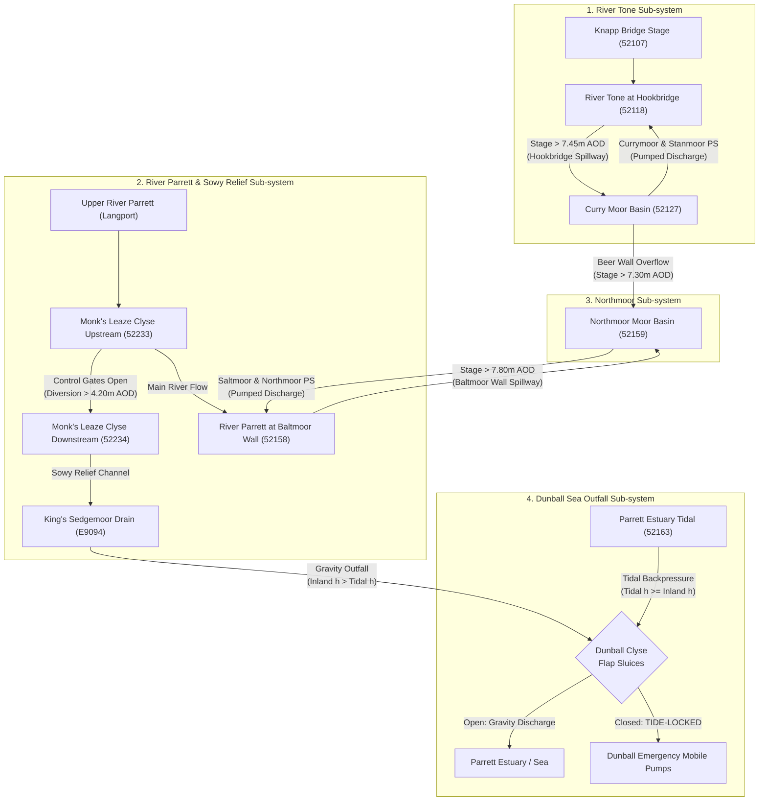

# Somerset Levels & Moors Hydrological Gauge Topology & Network Report

**Author:** Climate & Hydrology Scientist (`climate_hydrology_scientist`)  
**Date:** September 12, 2026  
**Data Source:** `scripts/gauge_topology.json` & `src/js/config/hydro_config.json`  
**Target Dashboard Gauges:** 52118, 52127, 52158, 52159, 52233, 52234, E9094, 52163  

---

## Executive Summary

The Somerset Levels and Moors catchment system (comprising the River Tone, River Parrett, Sowy Relief Channel, and King's Sedgemoor Drain) represents one of the most complex, low-gradient hydraulic systems in the United Kingdom. Managed by the Environment Agency (EA) and Internal Drainage Boards (IDBs), flood mitigation relies on a combination of river levees (e.g. Baltmoor Wall), gravity spillways (Hookbridge, Athelney, Beer Wall), controlled diversion clyses (Monk's Leaze), land basin pumping stations (Currymoor, Stanmoor, Saltmoor, Northmoor), and tide-locked sea outfalls (Dunball Clyse).

This report presents a comprehensive topological mapping of the 8 core telemetry gauges integrated into the **Somerset Levels & Moors Real-Time Dashboard**, detailing their exact geographic coordinates, catchment relationships, upstream/downstream linkages, and hydraulic operational functions.

---

## 1. Topological Summary Table

| Station ID | Station Name | Catchment / Watercourse | Latitude / Longitude | Easting / Northing | Direct Upstream Gauge / Structure | Direct Downstream Gauge / Structure | Primary Hydraulic Function |
| :--- | :--- | :--- | :--- | :--- | :--- | :--- | :--- |
| **52118** | Curry Moor (Hookbridge / River Tone) | River Tone / Tone Catchment | 51.054966, -2.936065 | 334489, 128820 | Knapp Bridge (`52107`), Bishops Hull (`52101`) | River Parrett Confluence at Burrowbridge; Hookbridge Spillway into Curry Moor (`52127`) | **River Stage Sensor**: Monitors River Tone channel elevation adjacent to Hookbridge Spillway ($Z_{\text{crest}} = 7.45\text{ m AOD}$). |
| **52127** | Curry Moor Basin | Currymoor Drain / Tone Floodplain | 51.054966, -2.936065 | 334489, 128820 | Hookbridge Spillway (River Tone `52118`), Athelney Spillway | Currymoor PS & Stanmoor PS (pumping to River Tone); Beer Wall Sluices to Northmoor | **Moor Catchbasin Level**: Measures impounded storage water level ($m\text{ AOD}$) in Curry Moor & Hay Moor basin. |
| **52158** | Northmoor (Baltmoor Wall / River Parrett) | Saltmoor Main Drain / River Parrett | 51.059531, -2.940994 | 334150, 129332 | Tone/Parrett Confluence, Monk's Leaze Clyse (`52233`) upstream | River Parrett downstream to Bridgwater; Baltmoor Wall Overtopping route into Northmoor (`52159`) | **River Stage & Levee Barrier**: Monitors River Parrett stage at Baltmoor Wall ($Z_{\text{crest}} = 7.80\text{ m AOD}$). |
| **52159** | Northmoor Moor Basin | Northmoor Main Drain / Parrett Floodplain | 51.074334, -2.965046 | 332486, 131000 | Baltmoor Wall Levee Overtopping (`52158`), Beer Wall Spillway ($7.30\text{ m AOD}$) | Saltmoor PS & Northmoor PS (pumping to River Parrett); Huntworth gravity drains | **Moor Catchbasin Level**: Measures impounded flood depth ($m\text{ AOD}$) within Northmoor & Saltmoor land storage basin. |
| **52233** | Monk's Leaze Clyse (Upstream Sowy) | River Parrett / Sowy Relief Diversion | 51.044626, -2.843820 | 340941, 127592 | Upper River Parrett (Langport / Huish Episcopi) | Monk's Leaze Clyse Gates ➔ Sowy Downstream Gauge (`52234`); Main River Parrett continues to Burrowbridge | **Sluice Gate Intake / Headwater Stage**: Monitors River Parrett headwater level at Monk's Leaze Clyse diversion intake ($Z_{\text{gate}} = 6.70\text{ m AOD}$). |
| **52234** | Monk's Leaze Clyse (Downstream Sowy) | Sowy Relief Channel / Sedgemoor System | 51.044626, -2.843820 | 340941, 127592 | Monk's Leaze Clyse Gates & River Parrett Upstream Gauge (`52233`) | Sowy Relief Channel ➔ Beer Wall Intake (Greylake) ➔ King's Sedgemoor Drain (`E9094`) | **Sluice Tailwater / Conveyance Control**: Monitors diverted flow stage inside Sowy Channel. Differential $\Delta h = h_{52233} - h_{52234}$ dictates diversion rate. |
| **E9094** | Dunball (Inland Sedgemoor Drain) | King's Sedgemoor Drain (KSD) | 51.161484, -2.988087 | 331002, 140713 | Sowy Relief Channel (`52234`), King's Sedgemoor Drain upper catchment | Dunball Clyse Flap Gates outfalling to Parrett Estuary (`52163`); Dunball Mobile Pumps | **Inland Terminal Stage**: Monitors KSD water level behind Dunball Clyse gates. Drives gravity discharge vs tide-lock logic against `52163`. |
| **52163** | Dunball Tidal (Parrett Estuary) | River Parrett Estuary (Tidal) | 51.162253, -2.989562 | 330900, 140800 | River Parrett (Bridgwater), Dunball Clyse outfall (`E9094`) | Bridgwater Bay / Bristol Channel Estuary | **Estuary Tidal Stage**: Monitors macro-tidal oscillations in Parrett Estuary. Controls passive closure of Dunball flap sluices when $h_{52163} \ge h_{\text{E9094}}$. |

---

## 2. Detailed Hydrological Network & Sub-system Breakdown

---

## 3. Deep-Dive Hydraulic Descriptions per Station

### 1. Curry Moor (Hookbridge / River Tone) — ID: `52118`
* **Geographic Position:** ST3448928820 (Athelney / Hookbridge). Twin gauge co-located with `52127`.
* **River / Catchment:** River Tone (Parrett, Brue and West Somerset Streams catchment).
* **Hydraulic Role:** In-channel stage monitor for the River Tone. Located immediately adjacent to the engineered Hookbridge Spillway.
* **Operational Criticality:** The River Tone stage at `52118` determines whether water spills over Hookbridge Spillway into Curry Moor.
  * Baseline Spillway Crest: **7.45 m AOD**
  * Sill Elevation: **4.50 m AOD**
  * Max On Record: **8.099 m AOD** (10-Mar-2008)
  * Typical Operating Range: **4.713 m AOD to 7.297 m AOD**

### 2. Curry Moor Basin — ID: `52127`
* **Geographic Position:** ST3448928820 (Athelney). Co-located at Currymoor Pumping Station.
* **River / Catchment:** Currymoor Drain / Curry Moor & Hay Moor storage basin.
* **Hydraulic Role:** Impounded lowland basin water level sensor. Measures stored volume within the embanked moor behind Hookbridge Spillway.
* **Operational Criticality:** Controls pumping station activation thresholds:
  * **Winter Pump Triggers:** Lead pump at **4.00 m AOD**, Duty pump at **4.30 m AOD**, Mobile pumps ordered at **4.40 m AOD** / active at **4.60 m AOD**. Critical flood spill risk at **4.85 m AOD**.
  * **Summer Pump Triggers:** Lead pump at **4.60 m AOD**, Duty pump at **4.80 m AOD**.
  * Max On Record: **8.049 m AOD** (06-Feb-2014 - 2013/14 Great Somerset Floods).

### 3. Northmoor (Baltmoor Wall / River Parrett) — ID: `52158`
* **Geographic Position:** ST3415029332 (East Lyng / Saltmoor Barrier).
* **River / Catchment:** Saltmoor Main Drain / River Parrett channel.
* **Hydraulic Role:** River stage and levee margin sensor along Baltmoor Wall, protecting Northmoor from River Parrett overtopping.
* **Operational Criticality:** Monitors headwater level along the primary flood embankment:
  * Baseline Levee Crest Elevation: **7.80 m AOD** (raised post-2014).
  * Typical Operating Range: **3.548 m AOD to 3.972 m AOD**.
  * Max On Record: **6.103 m AOD** (16-Feb-2014).
  * If stage exceeds 7.80 m AOD, free overtopping occurs across Baltmoor Wall directly into Northmoor (`52159`).

### 4. Northmoor Moor Basin — ID: `52159`
* **Geographic Position:** ST3248631000 (Northmoor Green / Moorland).
* **River / Catchment:** Northmoor Main Drain / Northmoor & Saltmoor Lowland Basin.
* **Hydraulic Role:** Lowland storage basin water level sensor. Tracks flood impoundment in Northmoor.
* **Operational Criticality:** Dictates Northmoor PS and Saltmoor PS operation:
  * Ground Level / Typical Range: **2.50 m AOD to 3.42 m AOD**.
  * **Winter Pump Triggers:** Saltmoor PS Lead at **3.40 m AOD** / Duty at **3.70 m AOD**; Northmoor PS Lead at **3.50 m AOD** / Duty at **3.80 m AOD**. Critical spill alert at **4.25 - 4.35 m AOD**.
  * Max On Record: **5.889 m AOD** (14-Aug-2009) / **5.824 m AOD** (08-Feb-2014).

### 5. Monk's Leaze Clyse (Upstream Sowy) — ID: `52233`
* **Geographic Position:** ST4094127592 (Langport / Aller). Twin gauge co-located with `52234`.
* **River / Catchment:** River Parrett headwaters at Sowy Relief intake.
* **Hydraulic Role:** Upstream stage sensor for Monk's Leaze Clyse diversion intake gates.
* **Operational Criticality:** Measures River Parrett stage prior to diversion:
  * Gate Structure Top Height: **6.70 m AOD**.
  * Diversion Operational Threshold: **4.20 m AOD** (EA opens gates to divert excess Parrett flows into the Sowy Relief Channel).

### 6. Monk's Leaze Clyse (Downstream Sowy) — ID: `52234`
* **Geographic Position:** ST4094127592 (Langport / Aller). Co-located at Monk's Leaze Clyse structure.
* **River / Catchment:** Sowy Relief Channel (artificial flood relief channel connecting Parrett to King's Sedgemoor Drain).
* **Hydraulic Role:** Sluice gate tailwater and channel conveyance stage monitor.
* **Operational Criticality:** Paired with `52233` to compute differential head $\Delta h = h_{52233} - h_{52234}$.
  * Open / Gravity Diversion Mode: $0.05\text{m} \le \Delta h < 0.20\text{m}$. Max design diversion capacity: **17.0 m³/s**.
  * Prevents over-allocation into the Sowy when King's Sedgemoor Drain is near capacity.

### 7. Dunball (Inland Sedgemoor Drain) — ID: `E9094`
* **Geographic Position:** ST3100240713 (Bridgwater / Dunball).
* **River / Catchment:** King's Sedgemoor Drain (KSD) inland terminal outfall.
* **Hydraulic Role:** Inland channel stage sensor directly behind Dunball Clyse tidal flap gates.
* **Operational Criticality:** Serves as the inland reference for sea outfall operations:
  * Typical Operating Range: **1.00 m AOD to 3.50 m AOD**.
  * Max On Record: **4.071 m AOD** (29-Nov-2012).
  * Dunball Emergency Mobile Pumps threshold: Lead at **2.80 m AOD** (Winter) / **3.10 m AOD** (Summer).

### 8. Dunball Tidal (Parrett Estuary) — ID: `52163`
* **Geographic Position:** ST330900140800 (Dunball / Parrett Estuary). Co-located on the estuary side of Dunball Clyse.
* **River / Catchment:** River Parrett Estuary (Macro-tidal marine environment).
* **Hydraulic Role:** Marine tidal stage sensor recording tide height in the Parrett Estuary.
* **Operational Criticality:** Governs passive hydraulic flap gate behavior at Dunball Clyse:
  * Max On Record: **7.094 m AOD** (21-Feb-2019 tidal surge).
  * **Tide-Locking Condition:** When $h_{52163} \ge h_{\text{E9094}}$, the higher head of the ocean keeps flap gates tightly closed. Gravity discharge stops completely until the tide recedes below the inland KSD stage.

---

## 4. Key Hydrological Conclusions & Operational Notes

1. **Dual Twin-Gauge Sites:**
   * **Currymoor Pumping Station** houses both `52118` (River Tone stage) and `52127` (Curry Moor Basin stage), allowing instant calculation of overtopping head across Hookbridge Spillway ($7.45\text{ m AOD}$).
   * **Monk's Leaze Clyse** houses both `52233` (Upstream River Parrett) and `52234` (Downstream Sowy Channel), providing real-time differential head $\Delta h$ to infer sluice gate opening status.
   * **Dunball Outfall** links `E9094` (Inland KSD) and `52163` (Parrett Estuary Tidal), allowing direct inference of gravity discharge vs tide-locked states.

2. **Inter-catchment Relief Architecture:**
   * The Sowy Relief Channel is a crucial hydraulic bypass. Opening Monk's Leaze Clyse (`52233`/`52234`) diverts up to $17\text{ m}^3/\text{s}$ away from the vulnerable Tone/Parrett confluence at Burrowbridge (`52118`/`52158`), shunting flow directly into King's Sedgemoor Drain and out through Dunball (`E9094`).

3. **Multi-Hazard Tide Locking Vulnerability:**
   * High spring tides at Dunball Tidal (`52163`) frequently exceed $6.0\text{ m AOD}$. When this coincides with heavy inland runoff down the Sowy Channel into `E9094`, Dunball Clyse becomes tide-locked for 4–6 hours per tide cycle, requiring deployment of high-capacity mobile pumps.
