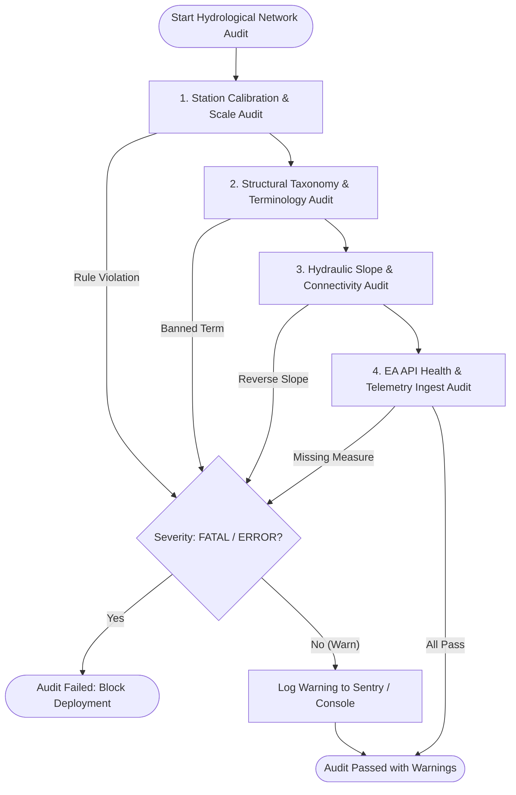

# Hydrological Validation Criteria & Domain Invariants: Somerset River Network Topology Audit

**Role:** Climate & Hydrology Scientist (`climate_hydrology_scientist`)  
**Date:** October 18, 2026  
**Target Systems:** `scripts/full_river_network.json`, `src/js/config/catchments/somerset.json`, `src/js/config/hydro_config.json`, `server.js` (`/api/topology`), and `src/js/hydro_engine.js`  
**Classification:** Hydrological Domain Specification & Automated Audit Rubric  

---

## Executive Summary & Scope

The Somerset Levels and Moors represent one of Europe's most intricate and low-gradient engineered lowland drainage basins. Spanning roughly 650 km², large portions of the land surface sit below high-spring-tide level ($< 6.0\text{ m AOD}$) and below mean river bank levels. Flood management relies upon a delicate balance of:
1. Embanked arterial rivers acting as perched aqueducts (River Tone and River Parrett),
2. Fixed-crest gravity spillways routing excess flood discharge into designated storage moors (Hookbridge, Baltmoor Wall, Beer Wall),
3. Internal Drainage Board (IDB) and Environment Agency (EA) high-capacity land drainage pumping stations (Currymoor, Stanmoor, Saltmoor, Northmoor),
4. Controlled artificial relief channels (Sowy Relief Channel, King's Sedgemoor Drain), and
5. Macro-tidal flap sluices (Dunball Clyse) vulnerable to tide-locking twice daily.

Because real-time decisions, public alerts, and hydraulic routing models depend directly on incoming Environment Agency (EA) open telemetry, any undetected configuration drift, datum confusion (e.g. confusing relative stage with absolute elevation), or taxonomic error (e.g. treating an in-channel gauge as an overtopping spillway) introduces catastrophic operational risk.

This document establishes an **uncompromising, mathematically rigorous set of hydrological validation criteria and domain invariants** designed to audit the entire Somerset river network topology. Every rule specified herein can be directly codified into an automated test harness to audit all data files and runtime API endpoints.

---

## 1. Station Calibration & Scale Invariants

### 1.1 Vertical Datum Definitions & Validation

Vertical consistency is paramount. Water elevation cannot be compared across stations unless converted to the same geodetic frame of reference.

```
       ▲  Elevation (mAOD)
       │
80.0m ─┼─ Upper Tone Catchment (e.g. Greenham: 76.14m AOD)
       │
       │
20.0m ─┼─ Mid Reach (e.g. Taunton Market: 13.12m AOD)
       │
 7.8m ─┼─ Baltmoor Wall Crest (7.80m AOD)
 7.45m─┼─ Hookbridge Spillway Crest (7.45m AOD)
 4.5m ─┼─ Normal Winter River Stage (Currymoor: 4.46m AOD)
 2.1m ─┼─ Curry Moor Polder Basin Invert / Ground (2.10m AOD)
 0.0m ─┼─ Ordnance Datum Newlyn (ODN / mAOD) = Mean Sea Level
       │
-2.0m ─┼─ Low Estuary Spring Tide / Excavated Sump
       ▼
```

1. **Definitions:**
   - **mAOD (metres Above Ordnance Datum Newlyn):** The UK national standard geodetic vertical datum, referenced to mean sea level at Newlyn, Cornwall. Required for all hydraulic head differentials, weir overtopping equations, backwater profiling, and downstream slope audits.
   - **mASD (metres Above Station Datum):** Water stage relative to an arbitrary local gauge datum established during station construction.
   - **Relative Channel Depth ($m$):** Measured water level above the local channel bed or pressure transducer zero point ($h_{\text{depth}} = h_{\text{stage}} - Z_{\text{bed}}$).

2. **Mathematical Transformation Invariant:**
   $$\forall \text{ station } i, \quad h_{i, \text{mAOD}} = h_{i, \text{mASD}} + Z_{\text{datum}, i}$$
   Where $Z_{\text{datum}, i}$ is the Environment Agency surveyed datum elevation in mAOD.

3. **Audit Invariants for Datum Integrity:**
   - **[RULE-DAT-01] Explicit Vertical Frame:** Every station entity and measure configuration MUST declare its vertical datum unit (`unit: "mAOD" | "mASD" | "m"`).
   - **[RULE-DAT-02] Mandatory Datum Offset:** If `unit` is `"mASD"` or `"m"`, the record MUST provide an EA-surveyed `datum_offset_mAOD` ($\mathbb{R}$). An unreferenced station datum is an automatic **FATAL** audit failure.
   - **[RULE-DAT-03] Spatial Plausibility of Datum Offset:** For the Somerset Levels basin, surveyed station datums must conform to known topographic bands:
     - Upper Catchment (Tone headwaters, Yeo headwaters): $+15.0\text{ m} \le Z_{\text{datum}} \le +85.0\text{ m AOD}$.
     - Lowland Floodplain & Moored Reaches: $+0.0\text{ m} \le Z_{\text{datum}} \le +15.0\text{ m AOD}$.
     - Estuarine Outfalls: $-3.0\text{ m} \le Z_{\text{datum}} \le +2.0\text{ m AOD}$.
   - **[RULE-DAT-04] Absolute Comparison Isolation:** No mathematical comparison ($\Delta h = h_u - h_v$) or slope calculation ($S = \frac{\Delta h}{L}$) may EVER be executed between readings of mixed datums. Both operands must be strictly converted to mAOD prior to arithmetic evaluation.

---

### 1.2 Alert Levels & Physical Operating Envelope Invariants

Alert thresholds, flood warning triggers, and sensor operating limits must reflect physical hydrodynamics.

1. **The Fundamental Operating Inequality:**
   For any in-channel river gauge or moor station $i$:
   $$\text{minOnRecord}_i \le Z_{\text{invert}, i} < \text{typicalRangeLow}_i < \text{typicalRangeHigh}_i < \text{alert\_level}_i \le \text{maxOnRecord}_i$$

2. **Audit Invariants for Alert Levels:**
   - **[RULE-ALT-01] Alert Strict Bounding:** Alert levels must strictly satisfy:
     $$\text{typicalRangeLow} < \text{alert\_level} \le \text{maxOnRecord}$$
   - **[RULE-ALT-02] No Sub-Invert Alerts:** An alert level must NEVER fall below or equal `minOnRecord` or the channel invert:
     $$\text{alert\_level} > Z_{\text{invert}} \quad \text{and} \quad \text{alert\_level} > \text{minOnRecord}$$
     *Hydrological Rationale:* Setting an alert level below typical low flow or near channel bed creates continuous false positive emergency states during baseflow.
   - **[RULE-ALT-03] Typical Range Sanity:** The typical operating range must be non-zero and positive:
     $$\text{typicalRangeHigh} - \text{typicalRangeLow} \ge 0.15\text{ m}$$
   - **[RULE-ALT-04] Maximum On Record Consistency:** Max on record must exceed typical high stage by at least a flood margin:
     $$\text{maxOnRecord} \ge \text{typicalRangeHigh} + 0.30\text{ m}$$
   - **[RULE-ALT-05] Polder Pumping Threshold Progression:** For storage moors (Curry Moor, Northmoor), pumping station thresholds must follow strict hydraulic sequencing:
     $$Z_{\text{ground}} < Z_{\text{lead\_pump}} < Z_{\text{duty\_pump}} < Z_{\text{mobile\_order}} < Z_{\text{mobile\_active}} \le \text{alert\_level} \le Z_{\text{crest}}$$
     *Example Validation (Curry Moor `52127`):*
     $2.10\text{ m (ground)} < 4.00\text{ m (lead)} < 4.30\text{ m (duty)} < 4.40\text{ m (mob order)} < 4.60\text{ m (mob active)} \le 6.50\text{ m (alert)} \le 7.45\text{ m (Hookbridge crest)}$.

---

### 1.3 Ground Elevation & Channel Invert Invariants

1. **Definitions:**
   - **Channel Invert ($Z_{\text{invert}}$):** The lowest geometric level of the channel thalweg (bed) at the gauging station cross-section.
   - **Moor Ground Elevation ($Z_{\text{ground}}$):** The lowest agricultural land level in an embanked polder basin where initial floodwater ponding occurs.

2. **Audit Invariants for Ground/Invert:**
   - **[RULE-INV-01] Sub-Stage Invert:** Channel invert elevation must be strictly below typical low stage:
     $$Z_{\text{invert}} < \text{typicalRangeLow}$$
   - **[RULE-INV-02] Minimum-on-Record Representation:** Channel invert represents physical bed contact or dry sensor conditions:
     $$Z_{\text{invert}} \le \text{minOnRecord} + 0.10\text{ m}$$
     Any reading $h < Z_{\text{invert}}$ indicates sensor drift, transducer unseating, or excavation of the stilling well.
   - **[RULE-INV-03] Basin Impoundment Zero:** For polder basins (`node_type: "polder_basin"`), telemetry readings below $Z_{\text{ground}}$ must report a clean dry-basin status:
     $$\text{water\_depth} = \max(0.0, \, h_{\text{basin}} - Z_{\text{ground}})$$
     Basin storage volume cannot be negative.

---

## 2. Structural Taxonomy & Terminology Invariants

### 2.1 Five-Class Structural Taxonomy

To eliminate confusing mixed semantics, every topological node in the Somerset network must be strictly assigned to exactly ONE of the following five structural classes:

```
┌──────────────────────────────────────────────────────────────────────────┐
│                   SOMERSET HYDRAULIC NODE TAXONOMY                       │
├───────────────────┬──────────────────────────────────────────────────────┤
│ 1. spillway       │ Broad-crested weir / levee overtopping into polder   │
│ 2. gauge          │ Standard in-channel fluvial or transfer stage gauge  │
│ 3. clyse_gate     │ Controlled sluice / diversion intake structure       │
│ 4. polder_basin   │ Lowland embanked flood storage retention moor        │
│ 5. tidal_outfall  │ Coastal / estuarine macro-tidal terminal outfall     │
└───────────────────┴──────────────────────────────────────────────────────┘
```

#### Detailed Class Specifications:

1. **`spillway` (Engineered Weir Overtopping Structure):**
   - **Definition:** Engineered broad-crested weir or armored levee section designed to spill water over its crest when upstream river stage exceeds $Z_{\text{crest}}$, relieving channel pressure and flooding adjacent polders.
   - **Mandatory Properties:**
     - `crest_elevation_mAOD` ($\mathbb{R}$, e.g. Hookbridge $7.45\text{ m}$, Baltmoor Wall $7.80\text{ m}$, Beer Wall $7.30\text{ m}$).
     - `sill_elevation_mAOD` ($\mathbb{R}$, bed approach).
     - `spillway_width_m` ($\mathbb{R}_{>0}$, e.g. Hookbridge $= 45.0\text{ m}$, Baltmoor $= 30.0\text{ m}$).
     - `discharge_model` (e.g. `"villemonte_submerged"`).
     - `diverts_to_node_id` (foreign key to a `polder_basin` node).
   - **Allowable Status Tokens:** `SECURE`, `NEAR_CREST`, `OVERTOPPING`, `SUBMERGED`, `REVERSE_SPILL`.

2. **`gauge` (In-Channel Conveyance Monitor):**
   - **Definition:** Standard in-stream river monitoring sensor recording river stage ($m$ or $m\text{ AOD}$) and/or flow rate ($m^3/s$) in an open channel.
   - **Mandatory Properties:**
     - `gauge_id` (EA station ID, e.g. `52108`, `52109`, `52111`, `52116`, `52119`, `52124`, `E9531`).
     - `river` (Watercourse name).
     - `alert_level_mAOD` ($\mathbb{R}$).
     - `downstream_node_id` (topological edge target).
   - **Allowable Status Tokens:** `NORMAL`, `ELEVATED`, `ALERT`, `OFFLINE`.

3. **`clyse_gate` (Controlled Gravity Sluice / Intake Structure):**
   - **Definition:** Engineered water control structure equipped with vertical guillotine gates, tilting weirs, or flap doors to control diversion into relief channels or maintain penning levels.
   - **Mandatory Properties:**
     - `gate_structure_top_mAOD` ($\mathbb{R}$, e.g. Monk's Leaze Clyse $6.70\text{ m}$).
     - `diversion_threshold_mAOD` ($\mathbb{R}$, e.g. $4.20\text{ m}$).
     - `sill_elevation_mAOD` ($\mathbb{R}$, e.g. $2.10\text{ m}$).
     - `tailwater_gauge_id` (paired downstream gauge, e.g. `52234`).
     - `max_design_flow_m3s` ($\mathbb{R}$, e.g. $17.0\text{ m}^3/s$).
   - **Allowable Status Tokens:** `CLOSED`, `PENNING`, `OPEN_DIVERTING`, `THROTTLED`, `SLACK_WATER`, `TIDE_LOCKED`.

4. **`polder_basin` (Embanked Lowland Moor Storage):**
   - **Definition:** Artificially embanked, bowl-shaped lowland agricultural basin (polder) disconnected from open gravity drainage during high river levels, accumulating impounded water.
   - **Mandatory Properties:**
     - `ground_elevation_mAOD` ($\mathbb{R}$, e.g. Curry Moor $2.10\text{ m}$, Northmoor $1.80\text{ m}$).
     - `pumping_station_ids` (array of associated PS records).
     - `alert_level_mAOD` ($\mathbb{R}$).
     - `crest_elevation_mAOD` (maximum containment embankment height before unmanaged overtopping into adjacent moors).
   - **Allowable Status Tokens:** `DRY`, `RETAINING`, `ALERT`, `PUMPING_LEAD`, `PUMPING_DUTY`, `PUMPING_EMERGENCY`, `CRITICAL_SPILL`.

5. **`tidal_outfall` (Macro-Tidal Marine Interface):**
   - **Definition:** The estuarine boundary interface where inland freshwater discharges through gravity tidal flap gates (clyses) or sea walls into the Bristol Channel / Parrett Estuary.
   - **Mandatory Properties:**
     - `tide_gauge_id` (e.g. Dunball Tidal `52163`).
     - `inland_gauge_id` (e.g. Dunball Inland `E9094`).
     - `clyse_sill_mAOD` ($\mathbb{R}$).
   - **Allowable Status Tokens:** `GRAVITY_DISCHARGE`, `TIDE_LOCKED`, `SURGE_WARNING`.

---

### 2.2 Banned Terminology & Cross-Taxonomy Invariants

To avoid catastrophic public misunderstanding and inaccurate flood intelligence:

- **[RULE-TAX-01] Gauges Must NEVER Have "Crest Heights":**
  A standard river gauge (`node_type: "gauge"`) measures continuous water stage within a channel cross-section. It DOES NOT possess a structural crest height.
  - *Constraint:* `node_type === 'gauge'` $\implies$ `crest_elevation_mAOD === undefined`.
- **[RULE-TAX-02] Gauges Must NEVER Have "Overtopping" Status:**
  A river gauge can be `NORMAL`, `ELEVATED`, or `ALERT` (e.g. near bankful). It NEVER "overtops". Overtopping is reserved exclusively for weirs, spillways, and flood levees.
  - *Constraint:* `node_type === 'gauge'` $\implies$ `status NOT IN ['OVERTOPPING', 'SUBMERGED', 'REVERSE_SPILL']`.
- **[RULE-TAX-03] Spillways Must NEVER Lack Crest Elevations:**
  A node classified as `spillway` MUST have a non-null, valid numerical `crest_elevation_mAOD`.
- **[RULE-TAX-04] Polders Must NEVER Be Treated as Free-Draining Channels:**
  A polder basin cannot have a downstream open river node target without an explicit pumping station or emergency gravity sluice link.
- **[RULE-TAX-05] Deprecation of Ambiguous Node Types:**
  All legacy and hybrid node types (`clyse_tailwater`, `spillway_channel`, `outfall_inland`) must be mapped strictly into the canonical five classes, with their hydraulic linkage represented by topological edge attributes (e.g. `edge_type: "diversion_tailwater"` or `edge_type: "gravity_flap_clyse"`).

---

## 3. Telemetry Health, Hydraulics & Flow Direction

### 3.1 Downstream Hydraulic Slope Invariant (The Downhill Invariant)

Under open-channel gravity flow in non-tidal inland reaches, water strictly obeys the conservation of energy and moves in the direction of negative hydraulic grade line:

$$S_f = -\frac{\mathrm{d}H}{\mathrm{d}x} > 0 \implies h_{\text{upstream}} > h_{\text{downstream}}$$

```
  Greenham (76.14m)
        \
         \  S > 0 (Steep Upland)
          ▼
     Bishops Hull (16.93m)
            \
             \
              ▼
         Taunton Market (13.12m)
                \
                 \
                  ▼
             Bathpool (5.92m)
                    \  S > 0 (Lowland Fluvial Gradient)
                     ▼
                Currymoor Hookbridge (4.47m)
```

1. **Topological Reach Gradient Inequality:**
   For any directed topological fluvial edge $(u \to v)$ where both $u$ and $v$ are in-channel river nodes (`node_type: "gauge" | "spillway"`) located above tidal influence:
   $$h_u(\text{mAOD}) - h_v(\text{mAOD}) \ge -\epsilon_{\text{tolerance}}$$
   Where $\epsilon_{\text{tolerance}} = 0.05\text{ m}$ accommodates transient wind seiche, minor wave action, or sensor discretization error.

2. **Downhill Slope Invariant Audit Rules:**
   - **[RULE-SLP-01] Upland Slope Positivity:** On steep upland reaches (e.g. Greenham $\to$ Bishops Hull $\to$ Taunton, or Chiselborough $\to$ Gaw Bridge), the drop must be strictly positive:
     $$\Delta h = h_{\text{upstream}} - h_{\text{downstream}} > 0.50\text{ m}$$
     A negative or zero $\Delta h$ indicates severe sensor calibration error or inverted station datums.
   - **[RULE-SLP-02] Lowland Slope Non-Negativity:** On lowland reaches (e.g. Bathpool $\to$ Currymoor PS, or Gaw Bridge $\to$ Monk's Leaze Clyse):
     $$\Delta h = h_{\text{upstream}} - h_{\text{downstream}} \ge -0.05\text{ m}$$
   - **[RULE-SLP-03] Tidal Zone Demarcation Exemption:** Stations within the macro-tidal estuary reach (Parrett downstream of Oath Lock / Burrowbridge: `52124` West Quay, `52163` Dunball Tidal, and `E9094` Dunball Inland) are subject to tidal surge backwater ($h_{\text{sea}} > h_{\text{river}}$). These edges MUST be tagged with `is_tidal: true`.
     - When `is_tidal: true`, $h_v > h_u$ is permitted ONLY if $h_v$ is identified as an active tidal surge condition.
   - **[RULE-SLP-04] Polder Moor Decoupling:** Embanked polder basins (`52127`, `52159`) do NOT participate in the main-river downhill slope equation. In high flood events, the river stage adjacent to the polder is physically elevated above the moor floor ($h_{\text{river}} > h_{\text{polder}}$).

---

### 3.2 Environment Agency Open API Notation & Health Invariants

The data pipeline consumes real-time telemetry from the official EA Flood Monitoring REST API (`https://environment.data.gov.uk/flood-monitoring/`).

1. **Standard EA Notation Syntax Check:**
   Every configured measure ID must strictly match the official EA naming pattern:
   $$\text{\textasciicircum}[A-Za-z0-9\_]\{4,10\}\-(flow|level|temperature|rainfall|wind)\-[a-z0-9\_]\+\-i\-15\_min\-[a-zA-Z0-9\_]\+\$$$
   *Standard Valid Examples:*
   - `52118-level-stage-i-15_min-mAOD` (Stage in mAOD)
   - `52109-flow-water-i-15_min-m3_s` (Discharge in m³/s)
   - `52234-level-downstage-i-15_min-mAOD` (Downstage in mAOD)
   - `52163-level-tidal_level-i-15_min-mAOD` (Tidal stage in mAOD)

2. **Audit Invariants for Telemetry Health:**
   - **[RULE-EA-01] Endpoint Existence:** Every measure ID must exist in the EA open API registry, returning HTTP 200:
     $$\text{GET } \text{https://environment.data.gov.uk/flood-monitoring/id/measures/}\{measure\_id\} \implies 200\text{ OK}$$
   - **[RULE-EA-02] Telemetry Freshness Latency:** Ingested telemetry must not be stale:
     $$T_{\text{current}} - T_{\text{reading}} \le 180 \text{ minutes}$$
     *Note:* EA stations sample every 15 minutes, but upland dial-in telemetry often transmits every 60–120 minutes. Telemetry $> 3\text{ hours}$ old must trigger an `EA_TELEMETRY_STALE` warning. Telemetry $> 12\text{ hours}$ old triggers `STATION_OFFLINE`.
   - **[RULE-EA-03] Physical Plausibility Bounding:**
     $$-2.00\text{ m AOD} \le h_{\text{reading}} \le 100.00\text{ m AOD}$$
     Readings outside this range indicate transmission corruption (e.g. `9999.0` missing-data flag) and must be discarded.
   - **[RULE-EA-04] Maximum Rate of Change (Spike Detection):**
     $$\left| \frac{\Delta h}{\Delta t} \right| \le 1.50\text{ m/hour}$$
     A step increase $> 1.5\text{ m}$ in 15 minutes is physically impossible for the Somerset catchment and flags a sensor malfunction or line noise.
   - **[RULE-EA-05] Flat-Line Anomaly Detection:**
     If $\sigma(h_{t-48\text{h} \dots t}) < 0.001\text{ m}$ (standard deviation zero over 48 hours) while neighboring catchment gauges exhibit variance $\sigma > 0.05\text{ m}$, flag as `FROZEN_FLOAT_OR_PRESSURE_TRANSDUCER`.

---

## 4. Master Somerset Station Reference Matrix

The following table compiles the complete hydrological reference data, datum offsets, and operational bounds for all 18 core stations across the Somerset network.

| Station ID | Station Name | River / Watercourse | Taxonomy Class | Surveyed Datum (mAOD) | Typical Range (mAOD) | Alert Level (mAOD) | Invert / Bed (mAOD) | Max on Record (mAOD) | Downstream Node ID |
| :--- | :--- | :--- | :--- | :---: | :---: | :---: | :---: | :---: | :--- |
| **52108** | Greenham | River Tone | `gauge` | $+75.69$ | 75.83 – 76.50 | 76.60 | 75.60 | 77.20 | `52109` |
| **52109** | Bishops Hull | River Tone | `gauge` | $+16.58$ | 16.70 – 17.80 | 18.00 | 16.45 | 19.38 | `52111` |
| **52111** | Taunton Market | River Tone | `gauge` | $+12.47$ | 12.60 – 13.80 | 14.10 | 12.35 | 15.65 | `52162` |
| **52162** | Bathpool Outfall | River Tone | `gauge` | $0.00^*$ | 5.20 – 6.60 | 7.20 | 4.80 | 8.10 | `52118` |
| **52118** | Currymoor Hookbridge | River Tone | `spillway` | $0.00^*$ | 4.71 – 7.30 | 7.15 | 4.50 | 8.10 | `athelney_junction` |
| **52127** | Curry Moor Basin | Currymoor Drain | `polder_basin` | $0.00^*$ | 2.10 – 4.50 | 6.50 | 2.10 (Ground) | 8.05 | `currymoor_ps` |
| **52116** | Chiselborough | River Parrett | `gauge` | $+20.70$ | 20.75 – 21.60 | 22.00 | 20.65 | 23.40 | `52119` |
| **52119** | Gaw Bridge | River Parrett | `gauge` | $+10.00$ | 10.15 – 11.20 | 11.80 | 9.90 | 13.50 | `52233` |
| **52233** | Monk's Leaze Clyse (Up) | River Parrett | `clyse_gate` | $0.00^*$ | 3.50 – 6.50 | 6.70 (Gate Top) | 2.10 (Sill) | 7.95 | `52158` (Diversion: `52234`) |
| **52234** | Monk's Leaze Clyse (Down)| Sowy Relief Channel | `gauge` (tailwater) | $0.00^*$ | 3.20 – 6.30 | 6.50 | 2.05 (Bed) | 7.90 | `52157` |
| **52158** | Baltmoor Wall Saltmoor | River Parrett | `spillway` | $0.00^*$ | 3.55 – 3.97 | 7.50 | 3.20 | 6.10 (Post-14 Crest: 7.80) | `52124` |
| **52159** | Northmoor Basin | Northmoor Drain | `polder_basin` | $0.00^*$ | 1.80 – 3.42 | 4.00 | 1.80 (Ground) | 5.89 | `saltmoor_ps` |
| **52124** | West Quay Bridgwater | River Parrett (Tidal)| `gauge` | $0.00^*$ | 1.20 – 5.50 | 6.10 | 0.50 | 7.80 | `52163` |
| **52163** | Dunball Tidal | Parrett Estuary | `tidal_outfall` | $0.00^*$ | -1.50 – 6.50 | 5.50 | -2.50 | 7.09 | `sea_outfall` |
| **52157** | Beerwall Upstream | River Sowy | `spillway` | $0.00^*$ | 4.20 – 6.20 | 6.80 | 3.80 | 7.45 (Crest: 7.30) | `E9531` |
| **E9531** | Bradney | Kings Sedgemoor Drain | `gauge` | $0.00^*$ | 2.40 – 3.80 | 4.20 | 1.80 | 4.65 | `E9094` |
| **E9094** | Dunball Inland | Kings Sedgemoor Drain | `gauge` (outfall) | $0.00^*$ | 1.00 – 3.50 | 3.50 | 0.20 | 4.07 | `52163` |
| **52120** | Huish Episcopi | River Yeo | `gauge` | $0.00^*$ | 3.20 – 5.80 | 6.20 | 2.50 | 7.40 | `52233` (Parrett Conf) |

*\*Note: Stations marked $0.00^*$ broadcast natively in mAOD from the EA open API.*

---

## 5. Automated Audit Suite Specification & Test Harness Blueprint

To implement these domain invariants into the testing architecture (such as `tests/hydrological_network_audit.test.js`), the following structured test rubric must be executed:



### Invariant Audit Test Cases:

```javascript
/**
 * Automated Hydrological Domain Audit Suite (Blueprint)
 */
import test from 'node:test';
import assert from 'node:assert/strict';

// Test Suite 1: Station Calibration & Alert Invariants
test('AUDIT-01: Alert levels must fall strictly within typicalRangeLow < alert <= maxOnRecord', () => {
  for (const station of SOMERSET_STATIONS) {
    if (station.alert_level_mAOD !== undefined) {
      assert.ok(
        station.alert_level_mAOD > station.typical_range_low_mAOD,
        `[RULE-ALT-01] Station ${station.id} alert level (${station.alert_level_mAOD}) is not above typicalRangeLow (${station.typical_range_low_mAOD})`
      );
      assert.ok(
        station.alert_level_mAOD <= station.max_on_record_mAOD,
        `[RULE-ALT-01] Station ${station.id} alert level (${station.alert_level_mAOD}) exceeds maxOnRecord (${station.max_on_record_mAOD})`
      );
    }
  }
});

test('AUDIT-02: Channel invert / moor ground must be physically below typical stage and <= minOnRecord', () => {
  for (const station of SOMERSET_STATIONS) {
    assert.ok(
      station.invert_elevation_mAOD < station.typical_range_low_mAOD,
      `[RULE-INV-01] Station ${station.id} invert (${station.invert_elevation_mAOD}) is above typical low stage (${station.typical_range_low_mAOD})`
    );
  }
});

// Test Suite 2: Structural Taxonomy & Banned Terminology
test('AUDIT-03: Gauges must NEVER have crest heights or overtopping status', () => {
  for (const node of TOPOLOGY_NODES) {
    if (node.node_type === 'gauge') {
      assert.equal(
        node.crest_elevation_mAOD,
        undefined,
        `[RULE-TAX-01] Gauge node ${node.id} (${node.name}) must NOT have a crest_elevation_mAOD property`
      );
      assert.ok(
        !['OVERTOPPING', 'SUBMERGED', 'REVERSE_SPILL'].includes(node.status),
        `[RULE-TAX-02] Gauge node ${node.id} has invalid status ${node.status}. Only spillways can overtop.`
      );
    }
    if (node.node_type === 'spillway') {
      assert.ok(
        typeof node.crest_elevation_mAOD === 'number',
        `[RULE-TAX-03] Spillway node ${node.id} must define a valid numerical crest_elevation_mAOD`
      );
    }
  }
});

// Test Suite 3: Downstream Hydraulic Slope (Gravity Flow Direction)
test('AUDIT-04: Non-tidal fluvial reaches must strictly maintain downhill hydraulic gradient in mAOD', () => {
  for (const edge of TOPOLOGY_EDGES) {
    if (!edge.is_tidal && !edge.is_polder_storage) {
      const upstreamNode = getNode(edge.source_id);
      const downstreamNode = getNode(edge.target_id);
      const deltaH = upstreamNode.stage_mAOD - downstreamNode.stage_mAOD;
      assert.ok(
        deltaH >= -0.05,
        `[RULE-SLP-02] Inverted hydraulic slope detected from ${upstreamNode.id} (${upstreamNode.stage_mAOD}m AOD) to ${downstreamNode.id} (${downstreamNode.stage_mAOD}m AOD). Delta = ${deltaH.toFixed(2)}m`
      );
    }
  }
});

// Test Suite 4: Environment Agency API Health & Measure Existence
test('AUDIT-05: Every configured measure ID must exist and broadcast active readings in EA Open API', async () => {
  for (const measureId of CONFIGURED_MEASURE_IDS) {
    const url = `https://environment.data.gov.uk/flood-monitoring/id/measures/${measureId}`;
    const res = await fetch(url);
    assert.equal(res.status, 200, `[RULE-EA-01] Measure ID ${measureId} returned HTTP ${res.status}`);
    const data = await res.json();
    assert.ok(data.items && data.items.latestReading, `[RULE-EA-01] Measure ${measureId} missing latestReading payload`);
  }
});
```

---

## 6. Audit Invariant Failure Severity Matrix

When an automated audit fails, the system must trigger appropriate deployment and alerting actions according to this matrix:

| Failure Code | Severity | Description | Automated Action |
| :--- | :---: | :--- | :--- |
| `ERR_TAXONOMY_GAUGE_CREST` | **FATAL** | In-channel gauge configured with spillway crest height or overtopping status. | Fail build, halt deployment, notify UI team. |
| `ERR_DATUM_MISMATCH` | **FATAL** | Comparing or computing slope across mixed datums without transformation. | Block topology calculations, raise alert. |
| `ERR_ALERT_OUT_OF_BOUNDS` | **ERROR** | Alert level $< \text{typicalRangeLow}$ or $> \text{maxOnRecord}$. | Fail configuration validation test. |
| `ERR_INVERT_ABOVE_STAGE` | **ERROR** | Channel bed/invert elevation placed above normal river stage. | Fail geometry validation test. |
| `ERR_HYDRAULIC_SLOPE_REVERSAL` | **ERROR** | Fluvial non-tidal upstream stage lower than downstream stage by $> 5\text{cm}$. | Flag anomaly on dashboard, notify telemetry ops. |
| `WARN_EA_TELEMETRY_STALE` | **WARN** | Telemetry reading timestamp is between 3h and 12h old. | Display stale telemetry warning badge in UI. |
| `ERR_EA_MEASURE_OFFLINE` | **ERROR** | EA API returns 404 or reading timestamp is $> 12\text{h}$ old. | Fall back to last persisted reading in SQLite, flag OFFLINE. |
| `WARN_FROZEN_FLOAT_SENSOR` | **WARN** | Sensor reading static ($\sigma < 0.001\text{m}$) over 48h while river moves. | Flag sensor maintenance alert. |

---

## 7. Actionable Implementation Directives for Team Roles

1. **For the Full Stack Developer (`fullstack_developer`):**
   - Clean up `server.js` `/api/topology` endpoint: eliminate ambiguous node types (`clyse_tailwater`, `spillway_channel`, `outfall_inland`) and adopt the canonical 5 classes.
   - Enforce that gauge nodes never receive `crest_elevation_mAOD` or `overtopping` status.
2. **For the QA Test Engineer (`qa_test_engineer`):**
   - Implement the automated audit test suite in `tests/hydrological_network_audit.test.js` covering all rules specified in Section 5.
   - Include mock and live EA API validation runs in CI/CD pipeline.
3. **For the UI/UX Design Specialist (`ui_ux_designer`):**
   - Ensure card headers and tooltips strictly respect the taxonomy: never show "crest clearance" on an in-channel gauge card.
   - For spillways, retain dual comparison ($h_{\text{river}}$ vs $Z_{\text{crest}}$), Villemonte discharge ($m^3/s$), and overtopping state tokens.
