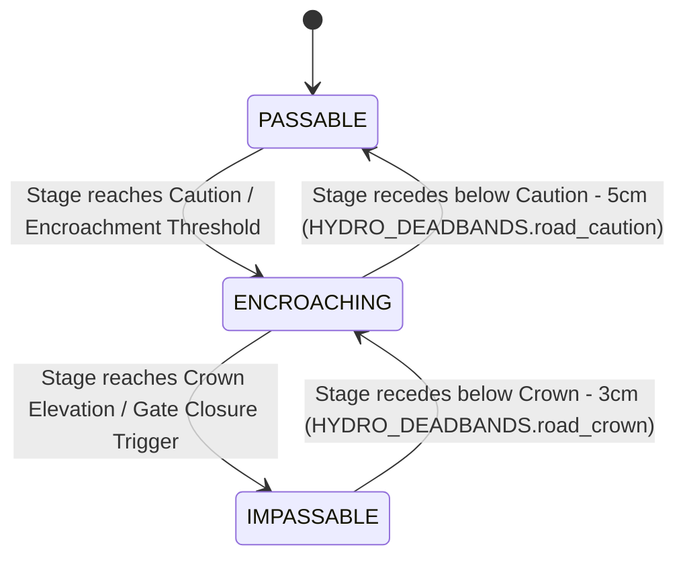

# Somerset Levels Road Network & Passability Specification

**Status:** Authoritative Hydrological & Highway Engineering Reference (v2.0)  
**Related GitHub Issue:** [#2 (UX: Elevate community road passability to dedicated interface)](https://github.com/heretic098/flood-telemetry/issues/2)  
**Governing Invariants:**
* `[RULE-HUM-01]` (Epistemic Humility & Ban on Simulated Authority: Plain facts, zero uncalibrated guesswork)
* `[RULE-PROV-01]` (Third-Party Data Stewardship: Raw EA and Highways telemetry; we are a transparent community conduit)
* `[RULE-SUB-01]` (Empirical Substantiation Invariant: No fabricated numbers; unconfirmed elevations must be documented as `UNSURVEYED / PENDING SURVEY`)
* `[RULE-ENT-01]` (Canonical Tripartite Entity Invariant: `asset_type: 'road' -> asset_id -> status: PASSABLE | ENCROACHING | IMPASSABLE`)

---

## 1. Context & Architectural Rationale

During initial prototyping, road passability indicators (such as the Cuts Road cascade and Muchelney road status) were intertwined with hydraulic spillway and river pumping cards on the main dashboard (`src/js/app.js`). 

However:
1. **Separation of Concerns:** A highway is a transportation asset, not an open-channel hydraulic weir or SCADA pumping station. Blending road closures into river spillway cards created cognitive clutter and metric confusion for residents.
2. **Distinct Failure Modes:** River spillways overtop by deliberate hydraulic design to relieve fluvial channels into agricultural polders; road inundation is a civil disruption requiring traffic diversion, signage, or emergency gate closures.
3. **Rigorous Empirical Provenance:** While surveyed civil elevations exist for engineered road-weir crossings like Cuts Road (Athelney Spillway) and the SRA-raised Muchelney Spine Road, other critical community access arteries (such as the A361 ridge, New Road, and Moorland access routes) operate on multi-agency flood trigger protocols where exact lowest road crown spot heights are unconfirmed in open data. In accordance with `[RULE-HUM-01]` and `[RULE-SUB-01]`, this platform explicitly differentiates between **Surveyed Civil Geometry (Tier 1)** and **Unsurveyed / Pending Survey** corridors.
4. **Dedicated Presentation:** Road passability is maintained as an independent domain model, ready for a dedicated **"Community Road Access"** card once comprehensive survey calibration across all flood arteries is completed.

---

## 2. Monitored Road Assets & Empirical Provenance Profiles

```
┌─────────────────────────────────────────────────────────────────────────────┐
│                       7 MONITORED ROAD ASSET CORRIDORS                      │
├─────────────────────────────────────────────────────────────────────────────┤
│  1. cuts_road               Cuts Road (East Lyng ↔ Athelney)                │
│  2. muchelney_access        Muchelney Spine Road (Huish Episcopi ↔ Muchelney)│
│  3. beer_wall_a372          A372 at Beer Wall / Greylake (Aller ↔ Othery)   │
│  4. new_road_curry          New Road (West Lyng ↔ North Curry)              │
│  5. a361_burrowbridge       A361 Corridor (East Lyng ↔ Burrowbridge)        │
│  6. bicknells_bridge_access Bicknell's Bridge & Huish Level Connectors      │
│  7. moorland_new_cut_road   New Cut & Moorland Access (Northmoor Polder)    │
└─────────────────────────────────────────────────────────────────────────────┘
```

---

### 2.1 Cuts Road (East Lyng ↔ Athelney)
* **Asset ID:** `cuts_road`
* **Asset Type:** `road`
* **Highway:** Cuts Road (also recorded historically as Cutts Road), carrying traffic between the A361 at East Lyng and Athelney across the southern embankment of Curry Moor.
* **Driving EA Telemetry Station:** `52127` (Curry Moor Polder Basin, `Currymoor Drain`).
* **Station Geodetic Datum:** $0.000\text{m AOD}$ (Direct mAOD Newlyn telemetry stream).
* **Survey Status:** **Surveyed Civil Geometry (Tier 1)**.
* **Correlated Optical Camera:** `athelney_cuts_rd` (direct live view of the Athelney Spillway road crossing).

| Operational Condition | Curry Moor Stage ($h_{\text{moor}}$) | Normalized Status | Practical / Physical Impact |
| :--- | :---: | :---: | :--- |
| **Normal Access** | $< 7.00\text{m AOD}$ | `PASSABLE` | Road crown is dry. Standard vehicular transit fully open. |
| **Margin Encroachment** | $\ge 7.00\text{m AOD}$ (to $7.34\text{m}$) | `ENCROACHING` | Water fills roadside rhynes and encroaches onto low verges ($10–35\text{cm}$ freeboard remaining). Low spots become damp/shallow. Somerset Highways deploy flood warning signs; advisory for low-clearance vehicles. |
| **Spillway Overtopping & Closure** | $\ge 7.35\text{m AOD}$ | `IMPASSABLE` | Floodwaters actively cascade over the engineered concrete **Athelney Spillway** across Cuts Road into Northmoor. Somerset Council emergency road closure gates locked shut; highway impassable to all traffic. |

#### Empirical Engineering Provenance & Citations:
- **Civil Weir Structure:** The Athelney Spillway is an intentional, concrete broad-crested relief weir surveyed at **$7.35\text{m AOD}$** (`src/js/config/catchments/somerset.json`). It provides an engineered emergency relief cascade from Curry Moor into Northmoor when Curry Moor reaches full capacity.
- **Operating Protocol:** Somerset Council operates physical **emergency road closure gates** at East Lyng and Athelney. When Currymoor Drain stage reaches $7.30\text{m}–7.35\text{m AOD}$, the gates are closed and locked to prevent vehicles entering deep fast-flowing water.
- **Primary Source Citations:**
  - Environment Agency: *Somerset Levels and Moors: reducing the risk of flooding* ([GOV.UK Publication](https://www.gov.uk/government/publications/somerset-levels-and-moors-reducing-the-risk-of-flooding))
  - Somerset Council: *Emergency road closure gates* ([Somerset Council Highways](https://www.somerset.gov.uk/roads-travel-and-parking/emergency-road-closure-gates/))
  - Catchment Configuration: `src/js/config/catchments/somerset.json` (Athelney Spillway baseline crest: $7.35\text{m AOD}$)

---

### 2.2 Muchelney Spine Road (Huish Episcopi ↔ Muchelney)
* **Asset ID:** `muchelney_access`
* **Asset Type:** `road`
* **Highway:** Langport Road / Muchelney Spine Road connecting the A372 at Huish Episcopi south to Muchelney village.
* **Driving EA Telemetry Station:** `52120` (River Yeo at Huish Episcopi Pumping Station).
* **Station Geodetic Datum:** $+5.000\text{m AOD}$ Newlyn (Stage in $\text{mASD} + 5.000 = \text{mAOD}$).
* **Survey Status:** **Surveyed Civil Geometry (Tier 1)**.
* **Correlated Optical Camera:** `huish_episcopi` (`#huish`).

| Operational Condition | River Yeo Stage ($h_{\text{yeo}}$) | Normalized Status | Practical / Physical Impact |
| :--- | :---: | :---: | :--- |
| **Normal Access** | $< 7.30\text{m AOD}$ ($< 2.30\text{m}$ depth) | `PASSABLE` | Normal vehicular transit open to Muchelney village. |
| **Low-Spot Encroachment** | $\ge 7.30\text{m AOD}$ ($\ge 2.30\text{m}$ depth) | `ENCROACHING` | River Yeo backwater spills into field hollows and ditches near Lawyers Mill and Huish Level. Somerset Highways "Road Liable to Flooding" signs deployed; tractor shuttle standby. |
| **Historic Road Submergence** | $\ge 7.70\text{m AOD}$ ($\ge 2.70\text{m}$ depth) | `IMPASSABLE` | Pre-2014 historical road crown submerged. Total vehicular isolation of Muchelney village under pre-2014 conditions (the 2013/2014 "Muchelney Island" scenario). |
| **Raised Crown Overtopping** | $\ge 7.86\text{m AOD}$ ($\ge 2.86\text{m}$ depth) | `IMPASSABLE` | Overtopping of the raised carriageway crown constructed in 2014–2015. Somerset Council emergency road closure gates locked shut; official boat/tractor shuttle mobilized. |

#### Empirical Engineering Provenance & Citations:
- **Low-Spot Breach ($7.30\text{m AOD}$):** Surveyed field hollow invert near Lawyers Mill where Yeo backwaters first spill onto road flanks (`src/js/config/catchments/somerset.json`: `muchelney_road: 7.30`).
- **SRA Road Raising Scheme ($7.86\text{m AOD}$):** Following the 10-week isolation of Muchelney in the winter of 2013/2014, Somerset County Council and the Somerset Rivers Authority (SRA), funded by £1m from the Department for Transport, raised a 500-metre section of the carriageway by up to $1.2\text{m}–1.3\text{m}$ (reaching $\approx 7.86\text{m}–8.00\text{m AOD}$). This secured vehicular access during routine annual flood events while preserving $7.30\text{m AOD}$ as the initial verge-encroachment caution threshold.
- **Primary Source Citations:**
  - Somerset Rivers Authority (SRA): *Muchelney Road Raising Scheme Project Review* ([SRA Project Archive](https://www.somersetriversauthority.org.uk/))
  - Somerset Council: *Emergency road closure gates* ([Somerset Council Highways](https://www.somerset.gov.uk/roads-travel-and-parking/emergency-road-closure-gates/))
  - Catchment Configuration: `src/js/config/catchments/somerset.json` (Huish Episcopi thresholds: `muchelney_road: 7.30`, `secondary_road: 7.86`)

---

### 2.3 A372 at Beer Wall / Greylake (Aller ↔ Othery Corridor)
* **Asset ID:** `beer_wall_a372`
* **Asset Type:** `road`
* **Highway:** A372 Langport to Bridgwater / Othery road at Beer Wall (near RSPB Greylake).
* **Driving EA Telemetry Station:** `52157` (River Sowy at Beerwall Upstream).
* **Station Geodetic Datum:** $0.000\text{m AOD}$ (Direct mAOD Newlyn telemetry stream).
* **Survey Status:**
  - Concrete Relief Weir Crest: **$7.30\text{m AOD}$ — Surveyed Civil Geometry (Tier 1)**.
  - Carriageway Crown Elevation: **UNSURVEYED / PENDING AS-BUILT HIGHWAYS TOPOGRAPHIC SURVEY** (`[RULE-HUM-01]`, `[RULE-SUB-01]`).

| Operational Condition | Sowy Stage at Beerwall ($h_{\text{sowy}}$) | Normalized Status | Practical / Physical Impact |
| :--- | :---: | :---: | :--- |
| **Normal Access** | $< 7.15\text{m AOD}$ | `PASSABLE` | Carriageway dry. Flow conveyed through standard Langacre Rhyne and Sowy culverts. |
| **High Sowy Flow / Pre-Spill** | $\ge 7.15\text{m AOD}$ (to $7.29\text{m}$) | `ENCROACHING` | Water level within 15cm of relief weir lip. Sowy diversion channel running near design bankfull capacity; spray, verge saturation, and ditch headlock risk. |
| **Relief Weir Overspill** | $\ge 7.30\text{m AOD}$ | `ENCROACHING` / `MONITORING` | Water actively overtops the concrete Beer Wall relief weir ($7.30\text{m AOD}$) and flows through the four $2\text{m} \times 3\text{m}$ culverts beneath the A372 into King's Sedgemoor Drain. The raised road remains passable while culverts operate at design discharge. |
| **Carriageway Inundation** | Exceeds Raised Road Crown | `IMPASSABLE` | Extreme event exceeding culvert hydraulic capacity resulting in carriageway overtopping. Official A372 diversion route activated via A361/A39. *(Exact crown elevation pending official Highways asset data).* |

#### Empirical Engineering Provenance & Citations:
- **Historical Context:** Historically, an ancient causeway ("Beer Wall") acted as a barrier across the floodplain, impounding water in the Sowy and Langacre Rhyne. In major floods, water overtopped the low road, cutting off the vital A372 route.
- **SRA Engineering Upgrade (2015–2016):** Somerset County Council and the SRA installed four large precast concrete box culverts (each $2\text{m}$ high $\times 3\text{m}$ wide) beneath the A372 and constructed an upgraded concrete relief weir surveyed at **$7.30\text{m AOD}$** with tilting weir control gates. This allows up to $17\text{ m}^3/\text{s}$ to pass under the highway rather than washing over the asphalt.
- **Epistemic Humility Note (`[RULE-HUM-01]`):** While the hydraulic weir crest is confirmed at $7.30\text{m AOD}$, the precise as-built asphalt road crown of the reconstructed A372 is not published in public EA flood monitoring tables. We explicitly mark the crown as `UNSURVEYED / PENDING SURVEY` rather than assuming a speculative number.
- **Primary Source Citations:**
  - Somerset Rivers Authority (SRA): *A372 Beer Wall Flood Alleviation Scheme & Sowy Enhancement* ([SRA Project Archive](https://www.somersetriversauthority.org.uk/))
  - Environment Agency: *River Sowy at Beerwall Upstream (52157)* ([EA Telemetry API](https://environment.data.gov.uk/flood-monitoring/id/stations/52157.html))
  - Catchment Configuration: `src/js/config/catchments/somerset.json` (Beer Wall baseline crest: $7.30\text{m AOD}$)

---

### 2.4 New Road (West Lyng ↔ North Curry across Curry Moor / Hay Moor)
* **Asset ID:** `new_road_curry`
* **Asset Type:** `road`
* **Highway:** New Road connecting the A361 at West Lyng southwards to North Curry, crossing the low-lying western basins of Curry Moor and Hay Moor.
* **Driving EA Telemetry Station:** `52127` (Curry Moor Basin, `Currymoor Drain`) [corroborating: `52118` Hookbridge on River Tone].
* **Station Geodetic Datum:** $0.000\text{m AOD}$ (Direct mAOD Newlyn telemetry stream).
* **Survey Status:**
  - Operational Gate Closure Protocol: **Tier 2 (Statutory / Agency Trigger Plan)**.
  - Carriageway Crown Elevation: **UNSURVEYED / PENDING HIGHWAYS TOPOGRAPHIC SURVEY** (`[RULE-HUM-01]`, `[RULE-SUB-01]`).

| Operational Condition | Curry Moor Stage ($h_{\text{moor}}$) | Normalized Status | Practical / Physical Impact |
| :--- | :---: | :---: | :--- |
| **Normal Access** | $< 6.20\text{m AOD}$ | `PASSABLE` | Carriageway completely clear and dry. |
| **Hay Moor Ditch Encroachment** | $\ge 6.20\text{m AOD}$ | `ENCROACHING` | Water rising across Hay Moor backing up through drainage rhynes; margin water overtops roadside grass verges in low sags. |
| **Emergency Gate Closure** | $\ge 7.00\text{m}–7.30\text{m AOD}$ (or on EA Warning) | `IMPASSABLE` | Somerset Council emergency road closure gates at West Lyng and North Curry locked shut. Highway impassable; traffic diverted via A358 / Thorne Falcon. |

#### Empirical Engineering Provenance & Citations:
- **Hydrological Inundation Sequence:** In severe flood events on the Tone catchment, Hookbridge Spillway overspills at $7.45\text{m AOD}$ into Curry Moor. As Curry Moor water levels rise past $5.80\text{m}$ (mobile pumps ordered) and $6.10\text{m}$ (emergency pumping), backwater propagates westwards into Hay Moor rhynes. Cuts Road typically floods first ($7.30\text{m}–7.35\text{m}$), with New Road encroached shortly thereafter.
- **Emergency Gate System:** Following the 2014 floods, Somerset County Council installed physical emergency closure gates at West Lyng and North Curry to prevent motorists being trapped in deep water across the moors.
- **Epistemic Humility Note (`[RULE-HUM-01]`):** Although operational gate closures are tightly correlated with Curry Moor stage relative to the EA Trigger Point Plan, precise geodetic spot heights along the New Road carriageway are not published in public civil engineering asset registers and remain documented as `UNSURVEYED / PENDING SURVEY`.
- **Primary Source Citations:**
  - Somerset Council: *Emergency road closure gates* ([Somerset Council Highways](https://www.somerset.gov.uk/roads-travel-and-parking/emergency-road-closure-gates/))
  - Environment Agency: *Flood Warning - Curry Moor and Hay Moor (051FWF124)* ([GOV.UK Flood Warning Service](https://check-for-flooding.service.gov.uk/target-area/051FWF124))
  - Environment Agency: *Somerset Levels & Moors Trigger Point Plan* (Currymoor Operational Chapter)

---

### 2.5 A361 Corridor (East Lyng ↔ Burrowbridge)
* **Asset ID:** `a361_burrowbridge`
* **Asset Type:** `road`
* **Highway:** A361 major regional arterial road connecting Taunton, Othery, and Glastonbury, running across the low ridge between Curry Moor and Northmoor.
* **Driving EA Telemetry Stations:**
  - Primary Fluvial/Moor Stations: `52127` (Curry Moor Basin) & `52158` (Baltmoor Wall / River Parrett at Burrowbridge).
  - Receiving Basin Station: `52159` (Northmoor Basin).
* **Station Geodetic Datums:** $0.000\text{m AOD}$ Newlyn.
* **Survey Status:**
  - Operational Gate Closure Protocol: **Tier 2 (Statutory / Agency Trigger Plan)**.
  - Carriageway Crown Elevation: **UNSURVEYED / PENDING AS-BUILT HIGHWAYS AUDIT** (`[RULE-HUM-01]`, `[RULE-SUB-01]`).

| Operational Condition | Fluvial & Polder Threshold Conditions | Normalized Status | Practical / Physical Impact |
| :--- | :---: | :---: | :--- |
| **Normal Access** | Normal river and polder baseflows | `PASSABLE` | Strategic arterial transport route fully open without restrictions. |
| **Moor Capacity Warning** | $h_{\text{curry}} \ge 7.35\text{m AOD}$ (Athelney cascade) AND $h_{\text{northmoor}} \ge 4.80\text{m AOD}$ | `ENCROACHING` | Water cascading from Curry Moor across Cuts Road into Northmoor; floodwaters approaching northern and southern toe embankments of the A361 ridge. Somerset Highways initiate active patrols. |
| **Arterial Closure** | Multi-agency closure order (or $h_{\text{baltmoor}} \ge 7.80\text{m AOD}$) | `IMPASSABLE` | Somerset Council emergency road closure gates locked shut at East Lyng and Burrowbridge. Carriageway closed to all traffic; major regional detour via Bridgwater/M5 or Langport. |

#### Empirical Engineering Provenance & Citations:
- **Civil Defense Role:** The A361 is the primary transportation artery across the central Somerset Levels. The road is constructed on a natural/engineered low marl and clay ridge. It stays open during standard seasonal floods when local minor moor roads (Cuts Road, New Road) are submerged.
- **Failure Mechanism:** In catastrophic events (such as winter 2013/2014), the inter-moor cascade across Athelney Spillway overwhelms Northmoor storage while the River Parrett at Baltmoor Wall reaches the $7.80\text{m AOD}$ levee overtopping crest. Water accumulating in Northmoor rises against the highway embankment, eventually spilling across the carriageway.
- **Emergency Gates:** Permanent heavy-duty road closure gates at East Lyng and Burrowbridge allow rapid closure when multi-agency tactical command determines flood water is imminent.
- **Epistemic Humility Note (`[RULE-HUM-01]`):** Carriageway spot heights along the ridge vary between $\approx 7.90\text{m}$ and over $8.50\text{m AOD}$. Because exact lowest breach elevations are not confirmed in open engineering registers, the asset crown is strictly classified as `UNSURVEYED / PENDING SURVEY`.
- **Primary Source Citations:**
  - Environment Agency: *Flood Warning - A361 East Lyng to Burrowbridge (051FWF126)* ([GOV.UK Flood Warning Service](https://check-for-flooding.service.gov.uk/target-area/051FWF126))
  - Somerset Council: *Emergency road closure gates* ([Somerset Council Highways](https://www.somerset.gov.uk/roads-travel-and-parking/emergency-road-closure-gates/))
  - Somerset Rivers Authority (SRA): *Burrowbridge and A361 Flood Resilience Scheme* ([SRA Project Archive](https://www.somersetriversauthority.org.uk/))

---

### 2.6 Langport / Huish Episcopi Local Connectors (Bicknell's Bridge & Huish Level)
* **Asset ID:** `bicknells_bridge_access`
* **Asset Type:** `road`
* **Highway:** Minor connectors including Bicknell's Bridge approach road and Huish Level lanes linking Huish Episcopi, Muchelney, and Langport.
* **Driving EA Telemetry Station:** `52120` (River Yeo at Huish Episcopi Pumping Station).
* **Station Geodetic Datum:** $+5.000\text{m AOD}$ Newlyn (Stage in $\text{mASD} + 5.000 = \text{mAOD}$).
* **Survey Status:**
  - Hydraulic Correlation: **Tier 2 / Tier 3 (EA Operating Calibration & Warning Envelope)**.
  - Bridge Soffit & Approach Crown Geometry: **UNSURVEYED / PENDING TOPOGRAPHIC SURVEY** (`[RULE-HUM-01]`, `[RULE-SUB-01]`).

| Operational Condition | River Yeo Stage ($h_{\text{yeo}}$) | Normalized Status | Practical / Physical Impact |
| :--- | :---: | :---: | :--- |
| **Normal Access** | $< 7.00\text{m AOD}$ ($< 2.00\text{m}$ depth) | `PASSABLE` | Minor rural connectors clear and passable. |
| **Approach Encroachment** | $\ge 7.00\text{m AOD}$ ($\ge 2.00\text{m}$ depth) | `ENCROACHING` | Water overtops roadside rhynes on Huish Level; approaches to Bicknell's Bridge experience shallow puddles in surface depressions. |
| **Bridge Approach Inundation** | $\ge 7.30\text{m AOD}$ ($\ge 2.30\text{m}$ depth) | `IMPASSABLE` | River Yeo backwater submerges approach lanes to Bicknell's Bridge. Impassable to conventional passenger vehicles; localized closures deployed. |

#### Empirical Engineering Provenance & Citations:
- **Historical Bridge Structure:** Bicknell's Bridge (Grade II listed, Historic England List Entry 1056588) is a single-span segmental arch bridge constructed in 1829–1830 by the Turnpike Trust carrying a minor highway over the River Yeo.
- **Hydraulic Behavior:** The bridge approaches cross un-embanked floodplain pasture on Huish Level. When River Yeo stage rises past $7.00\text{m AOD}$ (approaching the $7.30\text{m}$ Lawyers Mill low-point breach), water floods the bridge approaches, cutting off minor local connections between Huish Episcopi and Muchelney.
- **Epistemic Humility Note (`[RULE-HUM-01]`):** While flood stages correspond empirically to the $7.00\text{m}–7.30\text{m AOD}$ envelope on station 52120, exact deck soffit and approach crown spot heights have not been formally surveyed in modern geodetic registers and remain `UNSURVEYED / PENDING SURVEY`.
- **Primary Source Citations:**
  - Historic England: *Bicknell's Bridge, List Entry 1056588* ([Historic England Archive](https://historicengland.org.uk/listing/the-list/list-entry/1056588))
  - Environment Agency: *River Yeo at Huish Episcopi PS (Station 52120)* ([GOV.UK Flood Monitoring](https://check-for-flooding.service.gov.uk/station/3071))
  - Catchment Configuration: `src/js/config/catchments/somerset.json` (Huish Episcopi operational thresholds)

---

### 2.7 New Cut & Moorland Access Road (Northmoor Polder Basin)
* **Asset ID:** `moorland_new_cut_road`
* **Asset Type:** `road`
* **Highway:** Minor internal polder roads crossing Northmoor basin between Moorland, Fordgate, and West Waste (connecting towards Huntworth and Bridgwater).
* **Driving EA Telemetry Station:** `52159` (Northmoor Basin, `Northmoor Polder`).
* **Station Geodetic Datum:** $0.000\text{m AOD}$ (Direct mAOD Newlyn telemetry stream).
* **Survey Status:**
  - Basin Retention Triggers: **Tier 2 (EA Somerset Levels Trigger Point Plan: Northmoor Chapter)**.
  - Carriageway Crown Elevation: **UNSURVEYED / PENDING TOPOGRAPHIC SURVEY** (`[RULE-HUM-01]`, `[RULE-SUB-01]`).

| Operational Condition | Northmoor Basin Stage ($h_{\text{northmoor}}$) | Normalized Status | Practical / Physical Impact |
| :--- | :---: | :---: | :--- |
| **Normal Access** | $< 3.80\text{m AOD}$ | `PASSABLE` | Polder drainage ditches within normal seasonal envelope; all internal roads open. |
| **Rhyne Bankfull & Margin Encroachment** | $\ge 3.80\text{m AOD}$ (EA Basin Alert) | `ENCROACHING` | Storage water fills primary drainage rhynes; margin water encroaches upon lowest field access track verges near West Waste. |
| **Deep Storage / Carriageway Inundation** | $\ge 4.80\text{m}–5.20\text{m AOD}$ (Mobile Pump Stages) | `IMPASSABLE` | Extreme storage accumulation submerges internal polder road surfaces. Local road access between Moorland, Fordgate, and West Waste cut off; emergency pumps running at Northmoor and Saltmoor stations. |

#### Empirical Engineering Provenance & Citations:
- **Polder Basin Dynamics:** Northmoor has a surveyed basin floor elevation of $1.80\text{m AOD}$ (Tier 1 Surveyed). It relies entirely on permanent pumping stations at Saltmoor and Northmoor (with contractor mobile pumps deployed at $4.80\text{m}–5.20\text{m AOD}$) to evacuate floodwaters into the River Parrett.
- **Road Inundation:** Because the roads sit on the polder floor, extended retention periods submerge internal access lanes before permanent flood embankments at Baltmoor Wall ($7.80\text{m AOD}$) are threatened.
- **Epistemic Humility Note (`[RULE-HUM-01]`):** The basin floor is surveyed at $1.80\text{m AOD}$, and trigger stages are statutory (Tier 2), but specific road crown elevations across West Waste and New Cut are not confirmed in published engineering tables and remain `UNSURVEYED / PENDING SURVEY`.
- **Primary Source Citations:**
  - Environment Agency: *Somerset Levels & Moors Trigger Point Plan* (Northmoor & Saltmoor Operational Chapter)
  - Environment Agency: *Northmoor Basin Telemetry Station 52159* ([GOV.UK Flood Monitoring](https://check-for-flooding.service.gov.uk/station/3415))
  - Catchment Configuration: `src/js/config/catchments/somerset.json` (Northmoor Basin thresholds: `floor: 1.80m`, `alert: 3.80m`, `mobile_order: 4.80m`, `mobile_active: 5.20m`)

---

## 3. Normalized Entity State Architecture (`[RULE-ENT-01]`, `[RULE-TAX-06]`)

Every monitored road asset strictly adheres to the tripartite entity structure:
$$\forall \text{ road asset } R, \quad R \equiv \langle \text{asset\_type: 'road'}, \text{asset\_id}, \text{status: 'PASSABLE' | 'ENCROACHING' | 'IMPASSABLE'} \rangle$$

### Closed State Definitions for `road` Assets:
1. **`PASSABLE` (Severity Tier 1 - Nominal):**
   - Carriageway is dry and unobstructed by floodwaters.
   - Water levels remain safely below ditch/rhyne bankfull capacity and road verges.
2. **`ENCROACHING` (Severity Tier 3 - Warning):**
   - Floodwaters have reached roadside ditch bankfull level, splashing verges or covering shallow surface depressions ($< 15\text{cm}$ depth).
   - Passable with caution for high-clearance vehicles; warning signs deployed by Somerset Council Highways.
3. **`IMPASSABLE` (Severity Tier 4 - Critical):**
   - Water depth across carriageway exceeds safe vehicular thresholds ($> 15\text{cm}$) or active overtopping cascade is in progress.
   - Somerset Council emergency road closure gates locked shut; highway closed to all standard traffic.

### State Transition Model with Anti-Flapping Hysteresis:


- **Hysteresis Deadband Offsets (`HYDRO_DEADBANDS` in `src/js/hydro_engine.js`):**
  - Falling exit from `IMPASSABLE` requires a $-0.03\text{m}$ ($-3\text{cm}$) drop below crown elevation.
  - Falling exit from `ENCROACHING` requires a $-0.05\text{m}$ ($-5\text{cm}$) drop below caution threshold.
- **30-Minute Debounce Window:** As specified in `docs/hydrological_event_matrix_spec.md`, transitions out of elevated states require two consecutive nominal readings (30 minutes) before the event session is formally closed.

---

## 4. Summary Matrix of Road Corridors & Engineering Provenance

| Asset ID | Corridor Name | Driving EA Station | Station Datum | Caution / Encroaching Stage | Crown / Closure Stage | Provenance Tier | Survey Status |
| :--- | :--- | :---: | :---: | :---: | :---: | :---: | :---: |
| **`cuts_road`** | Cuts Road (East Lyng ↔ Athelney) | `52127` | $+0.00\text{m}$ (mAOD) | $7.00\text{m AOD}$ | $7.35\text{m AOD}$ | **Tier 1** (Crown)<br>**Tier 2** (Gates) | `📐 Surveyed` (7.35m ODN) |
| **`muchelney_access`** | Muchelney Spine Road | `52120` | $+5.00\text{m AOD}$ | $7.30\text{m AOD}$ | $7.86\text{m AOD}$ | **Tier 1** (Raised)<br>**Tier 2** (Breach) | `📐 Surveyed` (7.86m ODN) |
| **`beer_wall_a372`** | A372 at Beer Wall / Greylake | `52157` | $+0.00\text{m}$ (mAOD) | $7.15\text{m AOD}$ | $7.30\text{m AOD}$ (Weir) | **Tier 1** (Weir)<br>**Tier 4** (Buffer) | `⚠️ PENDING AS-BUILT ROAD SURVEY` |
| **`new_road_curry`** | New Road (West Lyng ↔ North Curry) | `52127` | $+0.00\text{m}$ (mAOD) | $6.20\text{m AOD}$ | $7.10–7.30\text{m AOD}$ | **Tier 2** (Plan) | `⚠️ PENDING TOPOGRAPHIC SURVEY` |
| **`a361_burrowbridge`** | A361 East Lyng ↔ Burrowbridge | `52127` / `52158` | $+0.00\text{m}$ (mAOD) | $7.35\text{m}$ (Cascade) | Multi-agency order | **Tier 2** (Plan) | `⚠️ PENDING HIGHWAYS AUDIT` |
| **`bicknells_bridge_access`** | Bicknell's Bridge & Huish Level | `52120` | $+5.00\text{m AOD}$ | $7.00\text{m AOD}$ | $7.30\text{m AOD}$ | **Tier 2 / Tier 3** | `⚠️ PENDING TOPOGRAPHIC SURVEY` |
| **`moorland_new_cut_road`** | New Cut & Moorland Access Roads | `52159` | $+0.00\text{m}$ (mAOD) | $3.80\text{m AOD}$ | $4.80–5.20\text{m AOD}$ | **Tier 2** (Trigger) | `⚠️ PENDING TOPOGRAPHIC SURVEY` |

---

## 5. UI Specification for Dedicated "Roads & Access" Card

When ready to implement in `src/index.html` and `src/js/app.js`:

```
┌────────────────────────────────────────────────────────────────────────┐
│ 🛣️ COMMUNITY ACCESS & ROAD PASSABILITY                                │
│ Real-time highway status based on surveyed elevations & agency triggers │
├────────────────────────────────────────────────────────────────────────┤
│ • Cuts Road (East Lyng ↔ Athelney)                                     │
│   [ 🟢 PASSABLE & DRY ]                                                │
│   Curry Moor Level: 4.48m AOD | Clearance to Spillway Crest: +2.87m    │
│   📷 [View Spillway Live Cam ↗]                                        │
├────────────────────────────────────────────────────────────────────────┤
│ • Muchelney Access (Huish Episcopi ↔ Muchelney)                        │
│   [ 🟢 PASSABLE & OPEN ]                                               │
│   River Yeo Level: 5.92m AOD | Clearance to Low Spot: +1.38m           │
│   📷 [View Huish Live Cam ↗]                                           │
├────────────────────────────────────────────────────────────────────────┤
│ • A372 at Beer Wall (Greylake Relief Corridor)                         │
│   [ 🟢 PASSABLE & OPEN ]                                               │
│   Sowy Level: 3.92m AOD | Clearance to Relief Weir: +3.38m             │
├────────────────────────────────────────────────────────────────────────┤
│ • New Road (West Lyng ↔ North Curry)                                   │
│   [ 🟢 PASSABLE & OPEN ]                                               │
│   Curry Moor Level: 4.48m AOD | Buffer to Margin Watch: +1.72m         │
├────────────────────────────────────────────────────────────────────────┤
│ • A361 Corridor (East Lyng ↔ Burrowbridge)                             │
│   [ 🟢 PASSABLE & OPEN ]                                               │
│   Regional Arterial Status: Unrestricted Transit                       │
└────────────────────────────────────────────────────────────────────────┘
```

This guarantees complete operational clarity for local Somerset residents and commuters while maintaining strict compliance with our domain invariants.
