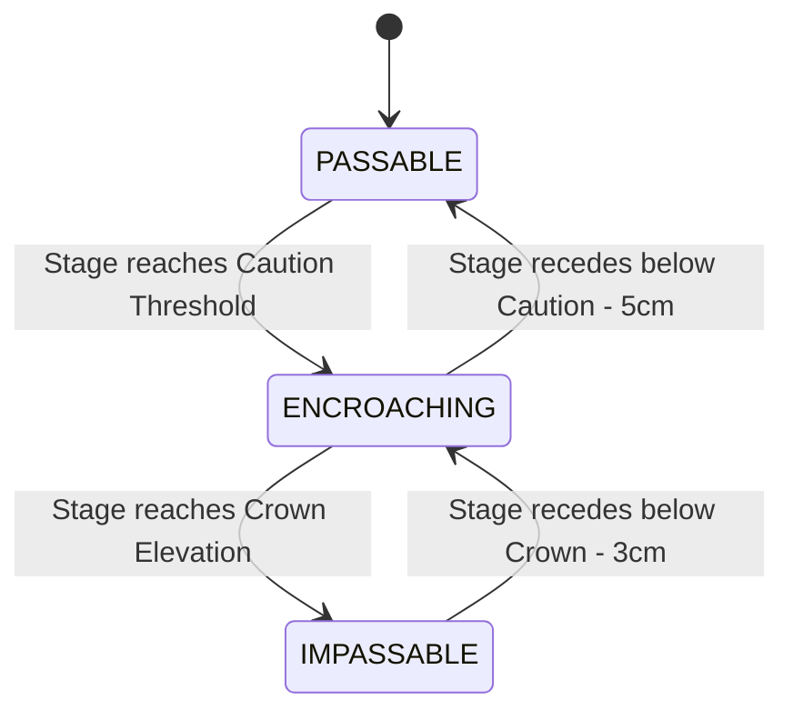

# Somerset Levels Road Network & Passability Specification

**Status:** Stashed / Deferred for Dedicated "Roads & Access" Card  
**Related GitHub Issue:** [#2 (UX: Elevate community road passability to dedicated interface)](https://github.com/heretic098/flood-telemetry/issues/2)  
**Governing Invariants:** `[RULE-HUM-01]` (Epistemic Humility), `[RULE-PROV-01]` (Third-Party Data Stewardship), `[RULE-SUB-01]` (Empirical Substantiation), `[RULE-ENT-01]` (Tripartite Entity: `asset_type -> asset_name -> status`).

---

## 1. Context & Architectural Rationale

During initial prototyping, road status indicators (such as Cuts Road cascade and Muchelney road status) were intertwined with hydraulic spillway and river pumping cards on the main dashboard (`src/js/app.js`). 

However:
1. **Separation of Concerns:** A road is a transportation asset, not an open-channel hydraulic weir or SCADA pumping station. Blending road closures into river spillway cards caused cognitive clutter and metric confusion.
2. **Incomplete Catchment Data:** While surveyed elevations exist for Cuts Road and Muchelney Spine Road, other critical community access routes (e.g. A361 East Lyng $\leftrightarrow$ Burrowbridge, Langport $\leftrightarrow$ Long Sutton, New Cut) lack calibrated continuous telemetry correlation.
3. **Dedicated Presentation:** Rather than adding an overcrowded ribbon or burying highway status inside river cards, road passability will be introduced as an independent, dedicated **"Community Road Access"** card once comprehensive survey data across all major flood arteries is compiled.

This document stashes all surveyed thresholds, operational triggers, and driving gauge correlations to preserve full engineering provenance.

---

## 2. Monitored Road Assets & Empirical Provenance

### 2.1 Cuts Road (East Lyng $\leftrightarrow$ Athelney)
* **Asset ID:** `cuts_road`
* **Highway:** Cuts Road (connecting A361 at East Lyng to Athelney across Curry Moor).
* **Driving EA Telemetry Station:** `52127` (Curry Moor Polder Basin, `Currymoor Drain`).
* **Geodetic Datum:** UK Ordnance Survey Datum Newlyn (mAOD).

| Operational Condition | Curry Moor Stage ($h_{\text{moor}}$) | Normalized Status | Practical / Physical Impact |
| :--- | :---: | :---: | :--- |
| **Normal Access** | $< 7.30\text{m AOD}$ | `PASSABLE` | Road crown is dry. Standard vehicular transit open. |
| **Verge Encroachment** | $\ge 7.30\text{m AOD}$ | `ENCROACHING` | Water fills roadside ditches and spills onto verges. Low sports become damp/shallow. Advisory for low-clearance vehicles. |
| **Spillway Overtopping** | $\ge 7.35\text{m AOD}$ | `IMPASSABLE` | Water actively cascades over the engineered concrete **Athelney Spillway** across Cuts Road into Northmoor. Highway closed; impassable to all normal traffic. |

#### Provenance:
- **Environment Agency Trigger Point Plan:** The Athelney Spillway is an intentional broad-crested concrete relief weir surveyed at **$7.35\text{m AOD}$** (`src/js/config/catchments/somerset.json`).
- When Curry Moor impoundment exceeds $7.35\text{m AOD}$, floodwater deliberately overflows the spillway and washes across Cuts Road down into Northmoor.
- Somerset County Council Highways and emergency services deploy road closure barriers once water reaches **$7.30\text{m}–7.35\text{m AOD}$**.
- **Correlated Webcam:** `athelney_cuts_rd` (direct optical view of the Cuts Road spillway crossing).

---

### 2.2 Muchelney Spine Road (Huish Episcopi $\leftrightarrow$ Muchelney)
* **Asset ID:** `muchelney_access`
* **Highway:** Muchelney Spine Road / Langport Road.
* **Driving EA Telemetry Station:** `52120` (River Yeo at Huish Episcopi Pumping Station).
* **Gauge Datum:** $+5.000\text{m AOD}$ (Stage in mASD $+ 5.000 = \text{mAOD}$).

| Operational Condition | River Yeo Stage ($h_{\text{yeo}}$) | Normalized Status | Practical / Physical Impact |
| :--- | :---: | :---: | :--- |
| **Normal Access** | $< 7.30\text{m AOD}$ ($< 2.30\text{m}$ depth) | `PASSABLE` | Normal vehicular transit open to Muchelney village. |
| **Low-Spot Encroachment** | $\ge 7.30\text{m AOD}$ ($\ge 2.30\text{m}$ depth) | `ENCROACHING` | River Yeo backwater spills into low spots and ditches near Lawns/Huish level. Somerset Highways "Road Liable to Flooding" signs deployed; tractor shuttle standby. |
| **Historic Cut-off** | $\ge 7.70\text{m AOD}$ ($\ge 2.70\text{m}$ depth) | `IMPASSABLE` | Pre-2014 road crown submerged. Total vehicular isolation of Muchelney village (the 2013/2014 "Muchelney Island" scenario). |
| **Raised Crown Overtopping** | $\ge 7.86\text{m AOD}$ ($\ge 2.86\text{m}$ depth) | `IMPASSABLE` | Exceeds the raised road crown constructed during the 2014/2015 Somerset Rivers Authority (SRA) £2.6m engineering scheme. |

#### Provenance:
- **Somerset Council & EA Multi-Agency Flood Response Plan:** The $7.30\text{m AOD}$ encroachment trigger represents the surveyed field hollows where water first breaches road flanks.
- **SRA Engineering Survey (2014):** In late 2014, Somerset County Council and the SRA raised a 500m section of the road crown to $\approx 7.86\text{m}–8.00\text{m AOD}$ (`src/js/config/catchments/somerset.json`), significantly reducing closure frequency while preserving $7.30\text{m AOD}$ as the initial caution threshold.
- **Correlated Webcam:** `huish_episcopi` (`#huish`).

---

## 3. Normalized Entity State Architecture (`[RULE-ENT-01]`)

When implemented, road passability will strictly adhere to the tripartite entity structure:
$$\text{Asset Type: } \texttt{road} \quad \longrightarrow \quad \text{Asset ID: } \texttt{cuts\_road} \mid \texttt{muchelney\_access} \quad \longrightarrow \quad \text{Status: } \texttt{PASSABLE} \mid \texttt{ENCROACHING} \mid \texttt{IMPASSABLE}$$

### State Transition Model with Anti-Flapping Hysteresis:


- **Hysteresis Deadband ($\delta_{\text{road}}$):** Falling exit from `IMPASSABLE` requires a $-0.03\text{m}$ drop below crown; falling exit from `ENCROACHING` requires a $-0.05\text{m}$ drop below caution.

---

## 4. UI Specification for Future Dedicated "Roads & Access" Card

When ready to implement, add a dedicated card to `src/index.html` and `src/js/app.js`:

```
┌────────────────────────────────────────────────────────────────────────┐
│ 🛣️ COMMUNITY ACCESS & ROAD PASSABILITY                                │
│ Real-time highway status based on surveyed floodwater elevations       │
├────────────────────────────────────────────────────────────────────────┤
│ • Cuts Road (East Lyng ↔ Athelney)                                     │
│   [ 🟢 PASSABLE & DRY ]                                                │
│   Water Level: 4.48m AOD | Clearance to Spillway Crest: +2.87m         │
│   📷 [View Spillway Live Cam ↗]                                        │
├────────────────────────────────────────────────────────────────────────┤
│ • Muchelney Access (Huish Episcopi ↔ Muchelney)                        │
│   [ 🟢 PASSABLE & OPEN ]                                               │
│   River Yeo Level: 5.92m AOD | Clearance to Low Spot: +1.38m           │
│   📷 [View Huish Live Cam ↗]                                           │
└────────────────────────────────────────────────────────────────────────┘
```

This ensures complete clarity for local residents without cluttering hydraulic spillway or pumping operational metrics.
