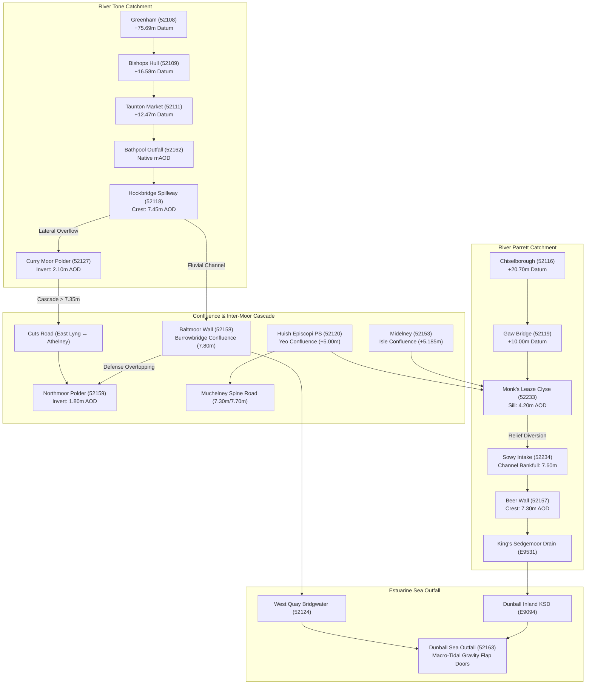
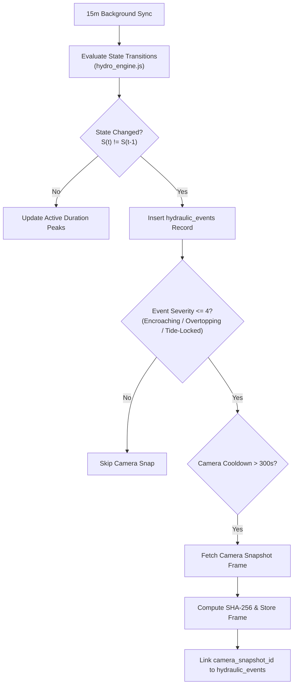

# Somerset Flood Telemetry Platform: System Architecture Specification (v2.0)

**Status:** Authoritative Production Architecture Standard  
**Date:** October 2026  
**Supersedes:** `docs/somerset_flood_telemetry_mvp_spec.md`, `docs/fullstack_technical_implementation_review.md`  
**Governing Invariants:** `.agents/AGENTS.md` (`RULE-HUM-01`, `RULE-PROV-01`, `RULE-SUB-01`, `RULE-ENT-01`, `RULE-CALC-01`, `RULE-PROC-01`, `RULE-SSOT-01`, `RULE-PAR-01`, `RULE-DEP-01`, `UI-VIS-01`)  
**Audience:** Platform Developers, Autonomous AI Agents, Community Flood Wardens, Public Contributors.

---

## 1. Foundational Philosophy & Non-Negotiable Invariants

This platform is an open-source, community-driven flood telemetry tool built to provide **transparent, understandable, and mathematically uncorrupted flood intelligence** for residents, parish flood wardens, and commuters across the Somerset Levels and Moors.

```
┌─────────────────────────────────────────────────────────────────────────────────┐
│                      CORE ARCHITECTURAL INVARIANTS MATRIX                       │
├─────────────────────────────────────────────────────────────────────────────────┤
│ [RULE-HUM-01]  Epistemic Humility: Ban on simulated civil engineering authority│
│ [RULE-PROV-01] Third-Party Stewardship: EA owns the data; do not extrapolate    │
│ [RULE-SUB-01]  Empirical Substantiation: Never assert unmeasured parameters     │
│ [RULE-ENT-01]  Tripartite Invariant: Every entity is (type -> name -> status)  │
│ [RULE-CALC-01] Ban on Volumetric Speculation: ZERO cumecs or fake volume        │
│ [RULE-SSOT-01] Single Source of Truth: All datums & thresholds in hydro_engine  │
│ [RULE-PAR-01]  Cross-Endpoint Parity: /api/status and /api/topology 100% aligned│
│ [RULE-DEP-01]  Dependency Hygiene: Zero unused dependencies in package.json    │
│ [UI-VIS-01]    Visual Inspection: Mandatory Headless Chrome screenshot audit    │
└─────────────────────────────────────────────────────────────────────────────────┘
```

### 1.1 The "Smell Test" Invariant (`[RULE-SUB-01]` & `[RULE-CALC-01]`)
- Environment Agency real-time sensors measure **water stage ($m$)**.
- We do **NOT** ingest:
  - River bathymetric cross-sections or stage-discharge rating curves ($Q(h)$);
  - Sluice gate aperture telemetry ($w$) at Monk's Leaze Clyse;
  - SCADA electrical run-states from IDB/EA pump motors.
- **Strict Rule:** Any attempt to calculate, integrate, or display volumetric discharge ($m^3/s$, cumecs, Megalitres/day, or volume $m^3$) is **STRICTLY PROHIBITED**.
- The system only reports what is measured with empirical ground-truth:
  1. **Water Stage ($mAOD$ / $m$ depth)**;
  2. **Structural Clearance ($m$)** relative to surveyed concrete weir crests or road crowns;
  3. **Duration ($h$)**;
  4. **Normalized Operational States**.

### 1.2 The Tripartite Entity Invariant (`[RULE-ENT-01]`)
$$\forall \text{ entity, UI card, map node, database record, or event } E, \quad E \equiv \langle \text{asset\_type}, \text{asset\_name}, \text{status} \rangle$$
No bespoke concatenated event strings (`CUTS_ROAD_START`, `MUCHELNEY_INUNDATION` are permanently banned).

---

## 2. The 19-Station Hydrological Network Model

The platform monitors 19 interconnected Environment Agency telemetry stations spanning the Tone, Parrett, Yeo, Isle, Sowy Relief Channel, and the macro-tidal Parrett Estuary.



---

## 3. Canonical Asset Taxonomy & Normalized Finite States

Every monitored physical asset in the network belongs to one of 6 canonical classes:

| Asset Type (`asset_type`) | Monitored Assets (`asset_id`) | Normalized States (`status`) | Description / Trigger Criteria |
| :--- | :--- | :--- | :--- |
| **`road`** | `cuts_road`<br>`muchelney_access` | `PASSABLE`<br>`ENCROACHING`<br>`IMPASSABLE` | **`PASSABLE`**: Dry, open to all vehicles.<br>**`ENCROACHING`**: Water on road margins / low spots (Curry Moor $\ge 7.30\text{m}$, Yeo $\ge 7.30\text{m}$). Caution.<br>**`IMPASSABLE`**: Road crown submerged; highway closed (Curry Moor $\ge 7.35\text{m}$, Yeo $\ge 7.70\text{m}$). |
| **`polder`** | `curry_moor`<br>`northmoor` | `STANDBY`<br>`DUTY_PUMPING`<br>`MOBILE_ORDERED`<br>`MOBILE_ACTIVE`<br>`CRITICAL` | Strictly calibrated to the **EA Somerset Levels Trigger Point Plan**:<br>• `MOBILE_ORDERED`: Curry Moor $5.80\text{m}$, Northmoor $4.80\text{m}$<br>• `MOBILE_ACTIVE`: Curry Moor $6.10\text{m}$, Northmoor $5.20\text{m}$<br>• `CRITICAL`: Curry Moor $6.50\text{m}$, Northmoor $5.60\text{m}$ |
| **`spillway`** | `hookbridge`<br>`baltmoor_wall`<br>`beer_wall` | `SECURE`<br>`NEAR_CREST`<br>`OVERTOPPING` | **`SECURE`**: Water level $> 30\text{cm}$ below crest.<br>**`NEAR_CREST`**: Water within $30\text{cm}$ of crest.<br>**`OVERTOPPING`**: River stage $\ge Z_{\text{crest}}$ (Hookbridge $7.45\text{m}$, Baltmoor $7.80\text{m}$, Beer Wall $7.30\text{m}$). |
| **`tidal_gate`** | `dunball_outfall` | `DISCHARGING`<br>`TIDE_LOCKED` | **`DISCHARGING`** (Estuarine Deep Blue `#0284c7`): Sea level below inland drain ($h_{\text{sea}} < h_{\text{inland}}$). Gravity flap open.<br>**`TIDE_LOCKED`** (Muted Slate `#64748b`): High tide backpressure ($h_{\text{sea}} \ge h_{\text{inland}}$). Flap sealed shut. |
| **`sluice`** | `monks_leaze_clyse` | `CLOSED`<br>`DIVERTING`<br>`THROTTLED`<br>`REVERSE_LOCK` | **`CLOSED`**: Stage $< 4.20\text{m}$ sill or $\Delta H \le 0.05\text{m}$. Routine penning.<br>**`DIVERTING`**: Stage $\ge 4.20\text{m}$ and $\Delta H > 0.10\text{m}$. Flood relief active.<br>**`THROTTLED`**: Downstream tailwater high ($h_{\text{sowy}} \ge 7.60\text{m}$).<br>**`REVERSE_LOCK`**: Downstream level higher than river ($h_{\text{sowy}} \ge h_{\text{parrett}}$). |
| **`gauge`** | 12 In-Channel Monitors | `NORMAL`<br>`ALERT` | In-channel open river monitor reporting in **Channel Depth** ($m$ depth). **STRICTLY BARRED** from possessing crest elevations or overtopping badges. |

---

## 4. Anti-Flapping Hysteresis Invariant (`HYDRO_DEADBANDS`)

To prevent high-frequency event toggling from wave ripples, wake, or sensor noise, state transitions strictly enforce directional deadbands declared centrally in `src/js/hydro_engine.js`:

```javascript
export const HYDRO_DEADBANDS = {
  weir_crest: 0.03,    // 3cm weir crest overtopping exit
  pre_spill: 0.05,     // 5cm approaching buffer exit
  polder_pump: 0.05,   // 5cm pumping station deactivation
  road_crown: 0.03,    // 3cm road inundation clearance exit
  road_caution: 0.05,  // 5cm road caution margin exit
  clyse_head: 0.05,    // 5cm dual-gauge differential head (exceeds 2-sigma combined sensor noise)
  tidal_flap: 0.05,    // 5cm sea flap cracking head differential
  river_gauge: 0.05    // 5cm in-channel flood alert clearance
};
```

> [!IMPORTANT]
> **Directional Causality:** Rising triggers are strictly exact ($h \ge h_{\text{threshold}}$). Deadbands apply **strictly to the falling/exit leg** ($h < h_{\text{threshold}} - \delta$).

---

## 5. UI/UX Architecture & Layperson Human-Centric Design

The interface is structured for **high-stress cognitive clarity**, eliminating visual clutter and prioritizing life-safety:

### 5.1 Community-First Road Access Ribbon (Issue #2)
Placed prominently directly beneath the global system banner:
```
🛣️ Cuts Road (East Lyng ↔ Athelney): PASSABLE (Water 2.87m below road crown)
🛣️ Muchelney Spine Road: PASSABLE (Water 1.38m below cut-off level)
🛡️ Moorland & Fordgate Defenses: SECURE (+4.09m margin to Baltmoor Wall)
```
A resident knows within **2 seconds** whether their commute or home is at risk.

### 5.2 Elimination of Double-Hero Redundancy (Issue #1)
Each catchment card presents **one single, unified hero block**:
- Primary Metric: Large, readable stage elevation ($mAOD$) or river depth ($m$ depth).
- Clearance Pill: Dynamic semantic pill (`🟢 2.46m below crest` / `▲ Overtopping by +14cm`).
- Baseline Context: Normal baseflow reference level.
- **Removed:** All duplicate 32px metric repetitions above sparklines.

### 5.3 Contextual Popovers for Technical Acronyms (Issue #3)
Interactive `(?)` tooltips define terms inline without forcing users to leave the dashboard:
- `mAOD`: *"Height above mean sea level. Local ground level is ~4.20m, so water is within normal banks."*
- `Crest Clearance`: *"Distance between current water level and the top of the concrete overflow weir."*
- `KSD`: *"King's Sedgemoor Drain: Man-made drainage channel evacuating water to the sea at Dunball."*
- `Penning`: *"Normal summer/autumn water retention level maintained for agriculture and ecology."*

### 5.4 Dual-View Visual Parity (`[UI-VIS-01]`)
- **Main Dashboard (`index.html`)** and **River Network Map (`topology.html`)** share 100% identical global status banners, counter pills, and station status tokens via `src/js/hydro_engine.js`.
- Verified on every change via `npm run snapshot` (`node scripts/capture_views.js`) and visual inspection of rendered screenshots.

---

## 6. Embedded Database Architecture (SQLite WAL)

The platform runs on an embedded, zero-dependency SQLite database in WAL (Write-Ahead Logging) mode.

### 6.1 Discrete Event Ledger (`hydraulic_events`)

```sql
CREATE TABLE IF NOT EXISTS hydraulic_events (
  id INTEGER PRIMARY KEY AUTOINCREMENT,
  asset_type TEXT NOT NULL CHECK(asset_type IN ('road', 'polder', 'spillway', 'tidal_gate', 'sluice', 'gauge')),
  asset_id TEXT NOT NULL,
  from_state TEXT,
  to_state TEXT NOT NULL,
  start_time TEXT NOT NULL,                    -- ISO 8601 UTC timestamp
  end_time TEXT,                              -- NULL while event is ACTIVE
  duration_seconds INTEGER,                   -- Populated on event closure
  trigger_stage_mAOD REAL NOT NULL,          -- Stage that tripped the threshold
  peak_stage_mAOD REAL NOT NULL,             -- Maximum water elevation during event
  structure_clearance_m REAL,                -- Clearance to crest or road crown
  severity INTEGER NOT NULL CHECK(severity BETWEEN 1 AND 5),
  camera_id TEXT,                            -- Correlated ground-truth webcam
  image_hash TEXT,                           -- SHA-256 hash of captured verification frame
  camera_snapshot_id INTEGER,                -- FK to camera_analysis record
  notes TEXT,                                -- Human-readable community explanation
  status TEXT NOT NULL CHECK(status IN ('ACTIVE', 'CLOSED', 'OCCURRED'))
);

CREATE INDEX IF NOT EXISTS idx_hydraulic_events_active 
  ON hydraulic_events(asset_id, status);

CREATE INDEX IF NOT EXISTS idx_hydraulic_events_start 
  ON hydraulic_events(start_time DESC);
```

### 6.2 Ground-Truth Camera Archive (`camera_analysis`)

```sql
CREATE TABLE IF NOT EXISTS camera_analysis (
  id INTEGER PRIMARY KEY AUTOINCREMENT,
  camera_id TEXT NOT NULL,
  image_hash TEXT NOT NULL,
  image_url TEXT NOT NULL,
  fetched_at TEXT NOT NULL,
  ai_evaluated INTEGER NOT NULL CHECK(ai_evaluated IN (0, 1)),
  analysis_json TEXT,
  trigger_reason TEXT NOT NULL,
  fallback_mode TEXT
);

CREATE INDEX IF NOT EXISTS idx_camera_analysis_cam_fetched 
  ON camera_analysis(camera_id, fetched_at DESC);
```

---

## 7. Camera Trigger & Visual Evidence Pipeline

Camera frame grabs are synchronized with discrete state transitions to provide visual ground truth:



---

## 8. Development Lifecycle & Review Protocol

Every future PR, feature extension, or refactoring pass must strictly follow this 3-step cycle:

1. **Spike $\to$ Consolidation Gate (`[RULE-PROC-01]`):** No prototype scaffolding may be merged or extended without an architectural consolidation pass.
2. **Automated Dual Audit Execution:** Must pass all 94+ tests in `npm test` (`tests/hydrological_network_audit.test.js` and `tests/topology_ui_ux_audit.test.js`).
3. **Mandatory Headless Chrome Visual Inspection (`[UI-VIS-01]`):** Must run `npm run snapshot` and visually inspect screenshots via `read_file` to verify zero overlapping SVG badges, matching CSS tokens, and cross-view parity.
4. **Cynical Reviewer Gate:** The reviewer must audit against the 10 core invariants, instantly rejecting any PR that violates epistemic humility, introduces uncalibrated cumecs, or breaches the tripartite `(asset_type -> asset_name -> status)` contract.
